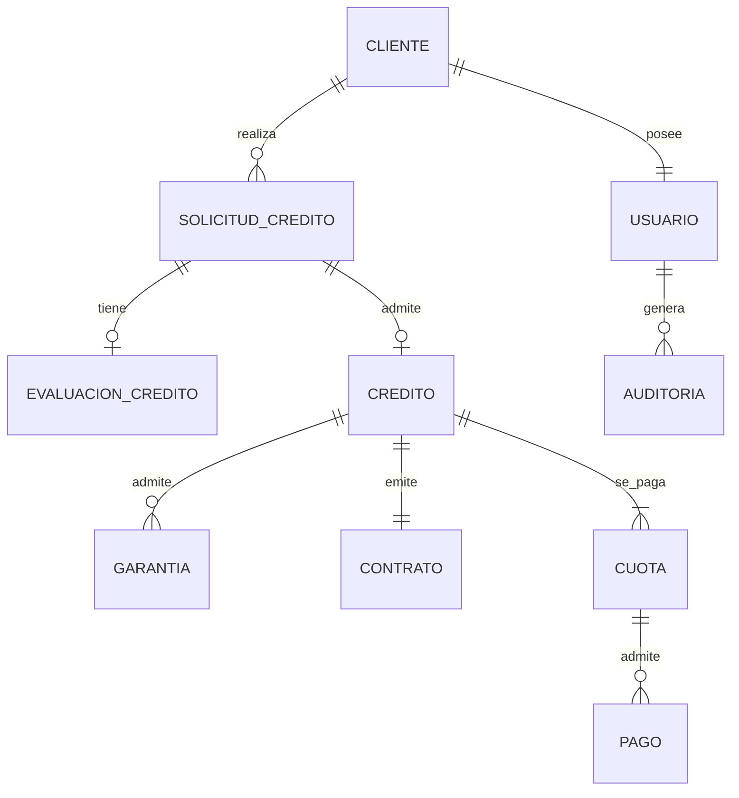
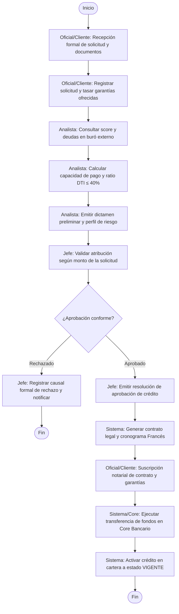
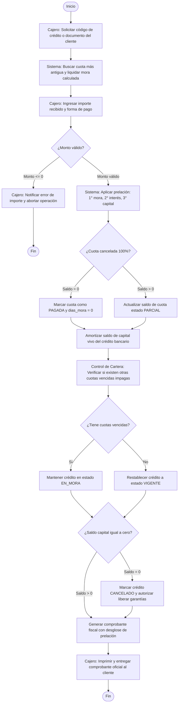
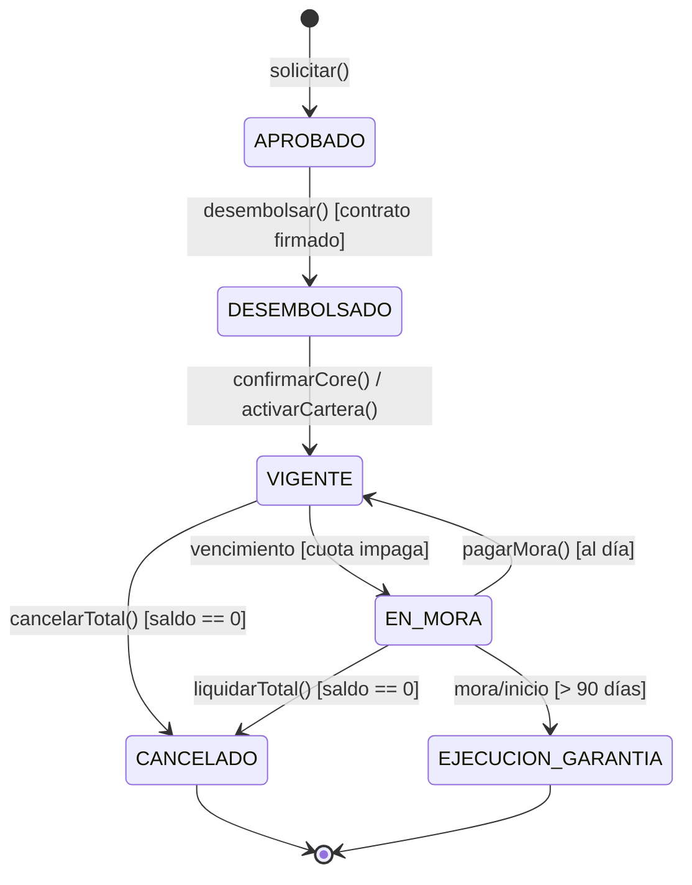
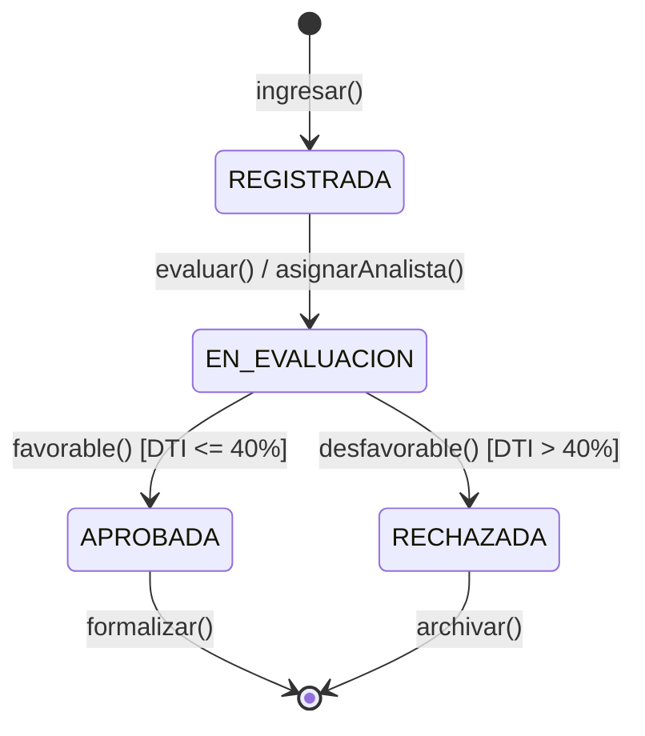
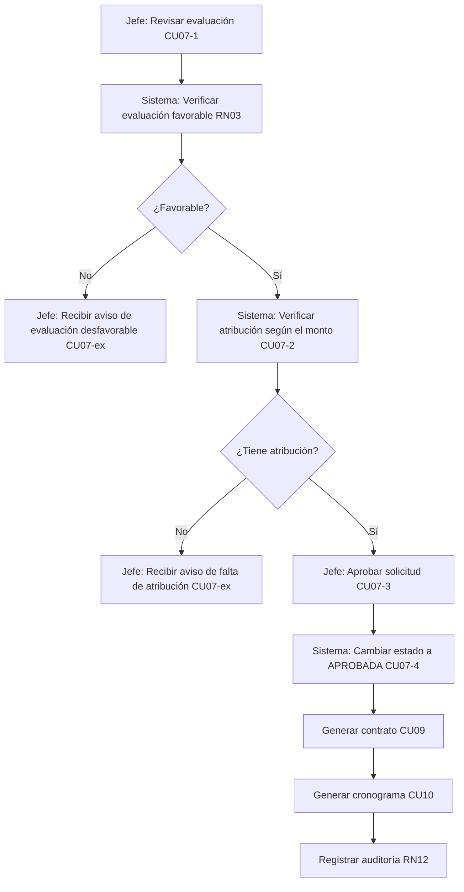
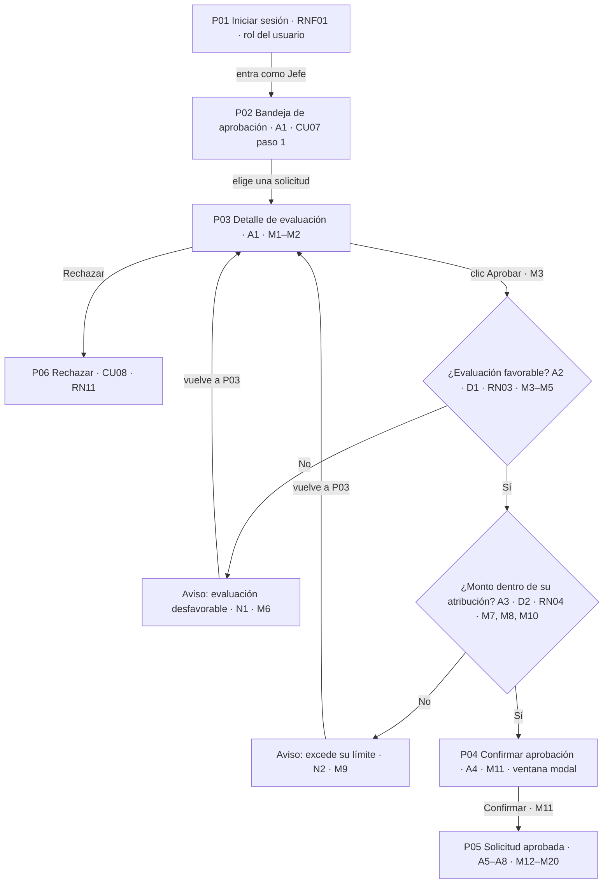
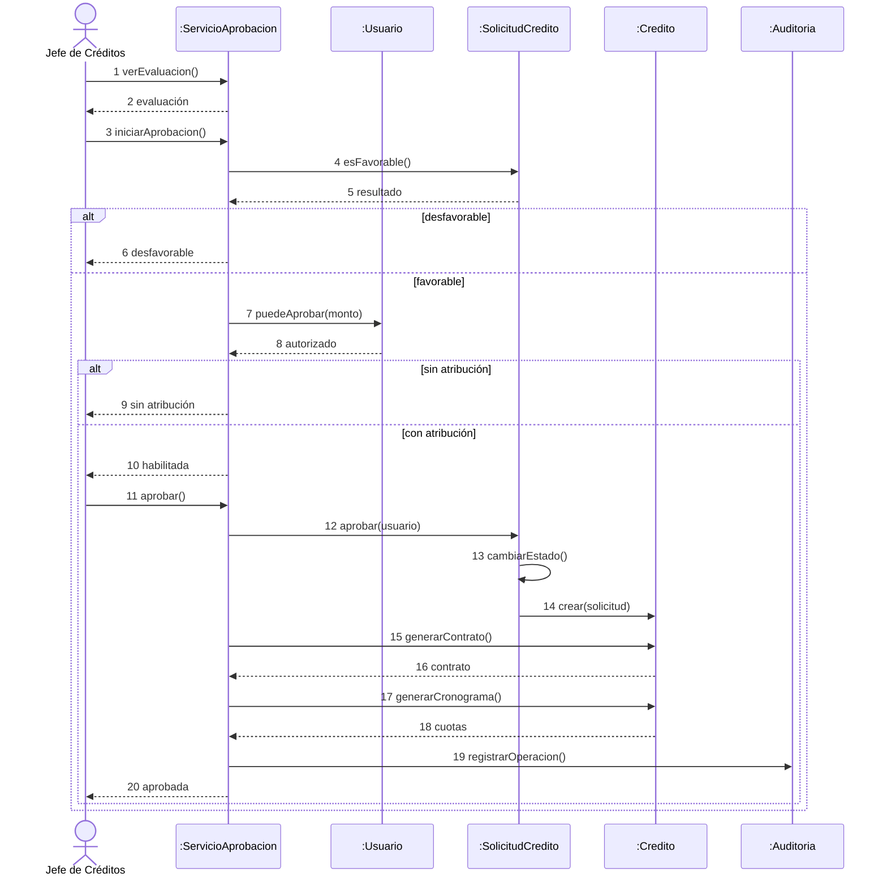

# PROYECTO DE ANÁLISIS Y DISEÑO DE SISTEMAS
## SISTEMA DE GESTIÓN DE CRÉDITOS PARA UNA ENTIDAD BANCARIA

**UNIVERSIDAD MAYOR DE SAN ANDRÉS**
**FACULTAD DE CIENCIAS PURAS Y NATURALES**
**CARRERA DE INFORMÁTICA**

**GRUPO 4:**

- BUSTILLOS CHOQUE MIGUEL ANGEL – CI: 13760600 – No: 21
- CALLISAYA SUMI SAÚL WALTER – CI: 15074779 – No: 24
- JAMACHI CONDORI ALEX ARTURO – CI: 13764342 – No: 64
- PATTY MAMANI ROYER MARCOS – CI: 13759002 – No: 87
- ROJAS GUACHALLA RANULFO ANTONIO – CI: 11076290 – No: 106 (Representante)

**MATERIA:** ANÁLISIS Y DISEÑO DE SISTEMAS I
**PARALELO:** "B"
**DOCENTE:** M. Sc. PATRICIA SONIA TRINO CAMACHO
**LA PAZ – BOLIVIA** · 11/10/2026

---

> **Nota de uso de este archivo.** Este Markdown reúne el 100 % del documento de la 1.ª entrega (INF241) y de la guía de trazabilidad de la auxiliar (P01–P13, RTM). Se aplicaron las decisiones del grupo (ver **Apéndice A: Registro de decisiones y correcciones**). Los diagramas originales son imágenes; aquí se transcriben a texto/Mermaid a partir de lo legible en ellas. Es la **base** sobre la que trabajará el grupo en la 2.ª entrega (sistema funcionando + matriz de trazabilidad).

## Índice

1. Introducción
2. Planteamiento del problema
3. Justificación
4. Objetivos
5. Alcance y límites
6. Descripción general de la solución
7. Actores del sistema
8. Requisitos funcionales
9. Requisitos no funcionales
10. Reglas de negocio
11. Casos de uso
12. Especificación detallada de casos de uso
13. Modelo de dominio
14. Modelo de datos
15. Diagramas UML
16. Arquitectura del sistema
17. Matriz de trazabilidad
18. Criterios de aceptación
19. Conclusiones
20. **Guía de trazabilidad: del requisito a la pantalla (auxiliar)**
- Apéndice A: Registro de decisiones y correcciones
- Apéndice B: Observaciones pendientes de resolver

---

## 1. Introducción

La gestión de créditos es una de las actividades más importantes en los bancos y las entidades financieras. Incluye registrar al cliente, recibir su solicitud, revisar su capacidad de pago, analizar el riesgo, aprobar el préstamo, firmar el contrato, desembolsar el dinero y hacer el seguimiento de las cuotas hasta que el crédito se cancela por completo. Cuando todos estos pasos se manejan de forma ordenada, la información está organizada y es más fácil controlar cada crédito desde que nace hasta que termina.

Por eso, este proyecto propone el diseño de un Sistema de Gestión de Créditos para una entidad bancaria. La idea es reunir en un solo lugar los datos de los clientes, las solicitudes, las evaluaciones crediticias, las garantías, los contratos, los desembolsos y los pagos. Con esto se busca que la información no esté dispersa, reducir los errores del trabajo diario, facilitar el seguimiento de las solicitudes y contar con datos confiables que ayuden a tomar decisiones.

En el sistema participan varios usuarios: el Oficial de Crédito, el Analista de Crédito, el Jefe de Créditos, el Cajero, el Administrador y el Gerente, y cada uno tiene funciones y permisos definidos. También interviene el Cliente, que es quien solicita el crédito y paga sus cuotas. Además, el sistema se relaciona con dos sistemas externos: uno de información de riesgo crediticio y el sistema bancario (Core Bancario), que se encarga de realizar los desembolsos. En el diseño, ambos se representan mediante interfaces de integración.

Para desarrollar el proyecto se parte del análisis de los procesos del negocio, se identifican los actores, se definen los requisitos funcionales y no funcionales y se establecen las reglas de negocio. Para mostrar la estructura, el comportamiento y las interacciones del sistema se utiliza el Lenguaje Unificado de Modelado (UML), junto con el modelo de dominio, el modelo de datos y la arquitectura lógica de la solución.

Finalmente, el propósito del proyecto es dejar una base de diseño clara, documentada y modular. Esta base permitirá implementar una versión académica funcional del sistema y, con futuras mejoras y validaciones técnicas, podría servir como punto de partida para una solución de software destinada a entidades financieras.

---

## 2. Planteamiento del problema

### 2.1. Situación problemática

En una entidad bancaria, otorgar y administrar créditos implica muchas actividades: registrar clientes, recibir solicitudes, reunir documentos, evaluar la capacidad de pago, analizar el riesgo, registrar garantías, aprobar, firmar contratos y desembolsar. Después también hay que controlar las cuotas, registrar los pagos, detectar la mora y verificar que el crédito se cancele.

Cuando todo esto se maneja con registros separados, hojas de cálculo o programas que no comparten información, es difícil mantener los datos actualizados y consistentes. Esto puede causar registros duplicados, errores en los datos, retrasos en la evaluación y dificultad para saber en qué estado está cada crédito. Además, los reportes deben armarse a mano juntando información de distintos lugares. Por eso se necesita un sistema que centralice los datos y permita seguir cada operación de forma ordenada, desde la solicitud hasta la cancelación.

### 2.2. Problema central

¿Cómo diseñar un Sistema de Gestión de Créditos que permita administrar de manera integrada, segura y trazable el otorgamiento y la administración de créditos bancarios, desde el registro del cliente y la solicitud hasta el desembolso, el seguimiento de los pagos y la cancelación del crédito?

### 2.3. Causas del problema

Este problema se origina principalmente porque la información de los clientes, las solicitudes y los créditos suele estar en distintos registros o herramientas, y no en un solo lugar. A esto se suma que la revisión de documentos y la evaluación de las solicitudes se hacen de forma manual, lo que complica seguir cada etapa del proceso. Además, la consulta de antecedentes crediticios no siempre está conectada al proceso y, al no haber un seguimiento centralizado, resulta difícil verificar las aprobaciones, los contratos y los desembolsos. Por último, generar los cronogramas, revisar las cuotas y armar los reportes a mano aumenta el trabajo del personal y la posibilidad de cometer errores.

### 2.4. Consecuencias del problema

Como resultado, la atención al cliente se demora, porque registrar, evaluar y responder una solicitud toma más tiempo. También es más probable que existan datos duplicados, incompletos o inconsistentes, y se hace más difícil conocer el estado y el historial de cada crédito. Por otro lado, resulta complicado auditar las operaciones, es decir, saber qué se hizo, quién lo hizo y con qué resultado. Además, las cuotas vencidas o la mora pueden detectarse tarde, y preparar reportes para la gestión exige más esfuerzo.

Por lo tanto, se requiere un sistema que integre la información crediticia, establezca un flujo controlado de operaciones y facilite el seguimiento de solicitudes, decisiones, desembolsos y pagos.

---

## 3. Justificación

El desarrollo del Sistema de Gestión de Créditos para una Entidad Bancaria se justifica por la necesidad de organizar e integrar los procesos de otorgamiento y administración de créditos, desde el registro del cliente y la solicitud hasta el desembolso, el seguimiento de pagos y la cancelación. La propuesta busca centralizar la información y establecer procedimientos controlados que faciliten el seguimiento de las operaciones y reduzcan los errores causados por un manejo desordenado de los datos.

### 3.1. Justificación operativa

El sistema ayudará a organizar el trabajo de los funcionarios que intervienen en el proceso crediticio: registrar clientes, gestionar solicitudes, revisar documentos, evaluar las condiciones financieras y dar seguimiento a las operaciones. También permitirá consultar el estado de cada solicitud y guardar un registro de las actividades realizadas, lo que mejora la continuidad y el control de los procesos.

### 3.2. Justificación administrativa

El sistema ofrecerá información ordenada sobre clientes, solicitudes, créditos aprobados, desembolsos, cuotas, pagos y mora. Esto facilitará la elaboración de reportes y permitirá que los responsables autorizados hagan consultas para supervisar las operaciones y tomar decisiones. Además, el control de usuarios y permisos ayuda a definir las responsabilidades de cada persona dentro de la entidad.

### 3.3. Justificación tecnológica

El proyecto permite aplicar principios de diseño orientado a objetos y usar UML para representar la estructura, el comportamiento y las interacciones del sistema. Definir módulos, modelos de datos, reglas de negocio y mecanismos de seguridad deja una base organizada para programar el software después. Además, un diseño modular facilita agregar mejoras y conectar otros sistemas externos en futuras versiones.

### 3.4. Justificación académica

Este proyecto permite aplicar lo aprendido en la materia Análisis y Diseño de Sistemas I: identificar el problema, definir objetivos, especificar requisitos, establecer reglas de negocio y elaborar los diagramas UML. También ayuda a entender cómo se relacionan los requisitos, los casos de uso, el modelo de dominio, la base de datos y la arquitectura del software.

### 3.5. Justificación de su proyección como producto de software

El proyecto también es una oportunidad para desarrollar una solución académica que, más adelante, podría convertirse en un producto de software para entidades financieras. La organización de los procesos, la separación de responsabilidades y la centralización de la información sirven como base para ampliarla según futuras necesidades. Sin embargo, para usarla en una entidad real se necesitarían validaciones adicionales de seguridad, cumplimiento normativo, políticas crediticias y compatibilidad con los sistemas bancarios existentes.

---

## 4. Objetivos

### 4.1. Objetivo general

Diseñar un Sistema de Gestión de Créditos para una Entidad Bancaria que permita administrar de manera integrada, segura y trazable el proceso crediticio, desde el registro del cliente y la solicitud inicial hasta la evaluación, aprobación, formalización, desembolso, seguimiento de pagos y cancelación del crédito, mediante la definición de requisitos, reglas de negocio, modelos de datos, arquitectura y diagramas UML.

### 4.2. Objetivos específicos

- Analizar los procesos del negocio relacionados con la gestión de créditos, desde que se recibe la solicitud hasta que el crédito se cancela.
- Identificar a los actores del sistema, tanto los usuarios internos como los sistemas externos, y definir qué hace cada uno.
- Definir los requisitos funcionales y no funcionales que necesita el sistema.
- Establecer las reglas de negocio que controlan el avance entre etapas y las autorizaciones.
- Modelar los casos de uso con sus flujos principales y alternativos.
- Diseñar el modelo de dominio y el modelo de datos, con sus entidades, atributos y relaciones.
- Elaborar los diagramas UML que muestren la estructura, el comportamiento y las interacciones del sistema.
- Definir la arquitectura del sistema, organizando sus módulos y capas, la seguridad y las integraciones externas.
- Establecer la trazabilidad entre los requisitos, los casos de uso y los modelos, junto con los criterios de aceptación.
- Dejar una base ordenada que sirva para implementar, validar y mejorar el sistema más adelante.

---

## 5. Alcance y límites

### 5.1. Incluye

- Administración integral de la cartera de clientes.
- Captura, seguimiento y consulta de solicitudes de crédito.
- Análisis y evaluación de la capacidad de endeudamiento y pago.
- Verificación del perfil de riesgo a través de integraciones automatizadas.
- Registro y administración de garantías vinculadas a las operaciones.
- Proceso de dictaminación (aprobación o rechazo) de expedientes crediticios.
- Emisión automatizada de contratos y proyección de cronogramas de pago.
- Ejecución de desembolsos vía integración directa con el ecosistema bancario.
- Contabilización y registro de abonos y amortizaciones.
- Monitoreo continuo y control sistemático de la cartera en mora.
- Generación de tableros de control y reportes para niveles operativos y gerenciales.
- Gestión de accesos, roles y perfiles de usuario dentro del sistema.

### 5.2. No incluye en esta versión

- Contabilidad general del banco.
- Procesamiento interno completo del Core Bancario.
- Modelos avanzados de inteligencia artificial para scoring.
- Gestión integral de recuperación judicial.
- Aplicación móvil independiente; se considera una posible interfaz futura.

> Nota: el modelo de dominio (13.1) y la máquina de estados del crédito (D08) contemplan la *ejecución judicial de garantías* como estado terminal. Se mantiene a pedido del grupo; ver Apéndice B, punto B1.

---

## 6. Descripción general de la solución

La arquitectura de la plataforma se estructurará mediante un enfoque modular, abarcando las áreas de: Seguridad, Clientes, Solicitudes, Evaluación, Créditos, Pagos, Reportes e Integraciones. Todos los datos transaccionales y maestros residirán de forma segura en un repositorio de datos centralizado. Asimismo, se contemplan interfaces de comunicación externa (APIs) que permitirán consultar el perfil de riesgo crediticio de los solicitantes y orquestar automáticamente las operaciones de desembolso hacia el sistema bancario principal.

| Módulo | Responsabilidad |
|---|---|
| Seguridad | Gestión de la autenticación, autorización, control de accesos y configuración de perfiles con privilegios restringidos. |
| Clientes | Captura, mantenimiento y actualización de la información demográfica y financiera estrictamente necesaria de los prospectos y clientes. |
| Solicitudes | Registro, seguimiento y consulta de las solicitudes de crédito (monto, plazo, destino, documentación presentada y estado). *(Descripción corregida: el original repetía la de Clientes.)* |
| Evaluación | Análisis del índice de capacidad de pago, calificación del nivel de exposición al riesgo y emisión de la recomendación técnica. |
| Créditos | Dictaminación final, formalización del contrato, instrucción de desembolso y monitoreo de la vigencia del crédito. |
| Pagos | Control de amortizaciones, aplicación de cobros, actualización de saldos insolutos y detección temprana de atrasos. |
| Reportes | Extracción y visualización de indicadores operativos (índices de morosidad, estatus de cuentas) y cuadros de mando gerenciales. |
| Integraciones | Interoperabilidad segura con servicios de buró de riesgo crediticio y el ecosistema del Core Bancario. |

---

## 7. Actores del sistema

| Actor | Descripción |
|---|---|
| Cliente | Usuario final que ingresa la solicitud de financiamiento y es el responsable legal de cumplir con las obligaciones de pago. |
| Oficial de Crédito | Enlace comercial encargado de la originación: perfila clientes, recaba la documentación de la solicitud y asienta las garantías. |
| Analista de Crédito | Especialista técnico que procesa la información financiera para determinar la viabilidad y el nivel de riesgo del solicitante. |
| Jefe de Créditos | Autoridad con poder de decisión para emitir la resolución final (aprobatoria o denegatoria) de acuerdo con sus límites de atribución. |
| Cajero | Operador responsable de procesar la recepción de las cuotas y de expedir los comprobantes oficiales de pago. |
| Administrador | Personal de soporte encargado de configurar el sistema, mantener el catálogo de usuarios, asignar roles y gestionar parámetros de seguridad. |
| Gerente | Directivo que utiliza la plataforma para el consumo de información estratégica, monitoreo de métricas operativas y toma de decisiones. |
| Sistema de Riesgo Crediticio | Entidad externa que suministra los antecedentes financieros y el historial de comportamiento de pago del solicitante. |
| Sistema Bancario Core | Plataforma central de la institución financiera encargada de materializar el fondeo y ejecutar las transacciones monetarias. |

---

## 8. Requisitos funcionales

> Las descripciones de RF10, RF11, RF14 y RF16 estaban duplicadas de otros requisitos en el original; se reemplazaron por descripciones tomadas de su caso de uso (CU09, CU10, CU13, CU15). Ver Apéndice A.

| ID | Requisito | Descripción | Prioridad |
|---|---|---|---|
| RF01 | Registrar cliente | El sistema deberá capturar de forma estructurada los datos de identificación, información personal indispensable, canales de contacto y el estado financiero básico. | Alta |
| RF02 | Actualizar cliente | La plataforma permitirá la modificación de los campos autorizados, garantizando la conservación de un historial de trazabilidad (auditoría) para cada cambio. | Media |
| RF03 | Registrar solicitud | El módulo habilitará el registro de los parámetros clave: monto solicitado, plazo de amortización, destino de los fondos y los datos de soporte. | Alta |
| RF04 | Consultar historial | El sistema ejecutará peticiones automáticas hacia los servicios de riesgo externos para consolidar los antecedentes crediticios del titular. | Alta |
| RF05 | Evaluar capacidad de pago | El motor de cálculo procesará los ingresos frente a los gastos declarados para proyectar el excedente financiero y la capacidad real de endeudamiento. | Alta |
| RF06 | Evaluar riesgo | La plataforma documentará y clasificará el nivel de riesgo asignado junto con el dictamen resultante de la evaluación integral. | Alta |
| RF07 | Registrar garantía | Habilitará la vinculación y registro de bienes o avales específicos que servirán como respaldo para la solicitud o el crédito vigente. | Alta |
| RF08 | Aprobar crédito | El sistema validará los límites de autorización del perfil del usuario en sesión para permitir la aprobación formal del expediente crediticio. | Media |
| RF09 | Rechazar crédito | Exigirá la tipificación obligatoria y la justificación detallada de los motivos por los cuales una solicitud ha sido declinada. | Media |
| RF10 | Generar contrato | El sistema generará el contrato del crédito aprobado, asignándole un número único, fecha y estado, y asociándolo al crédito para su firma. *(corregida)* | Alta |
| RF11 | Generar cronograma | El sistema calculará el capital y el interés de cada cuota a partir del monto, la tasa y el plazo, asignará las fechas de vencimiento y guardará el cronograma completo. *(corregida)* | Alta |
| RF12 | Desembolsar crédito | Orquestará la comunicación con el Core Bancario para instruir de forma automatizada la transferencia y liberación de los fondos. | Alta |
| RF13 | Registrar pago | Consignará los abonos recibidos por parte del cliente y ejecutará la actualización inmediata de los saldos insolutos en el sistema. | Alta |
| RF14 | Controlar mora | El sistema detectará las cuotas vencidas y sin pagar, las marcará como vencidas y cambiará el crédito a estado EN_MORA, registrando el evento. *(corregida)* | Alta |
| RF15 | Generar reportes | Dispondrá de herramientas para la extracción de estadísticas sobre la composición de la cartera, flujo de pagos, créditos emitidos y análisis de morosidad. | Media |
| RF16 | Administrar usuarios | Permitirá crear y modificar usuarios, asignarles un rol, activar o desactivar su acceso y registrar la auditoría de los cambios. *(corregida)* | Media |

---

## 9. Requisitos no funcionales

| ID | Categoría | Requisito | Cómo se verifica |
|---|---|---|---|
| RNF01 | Seguridad | El acceso será con usuario y contraseña. Las contraseñas se guardan cifradas (hash), nunca en texto plano. La cuenta se bloquea tras **5** intentos fallidos y la sesión se cierra tras 15 minutos sin actividad. | Pruebas de login con claves erróneas; revisión de la tabla USUARIO. |
| RNF02 | Confidencialidad | Cada rol solo ve la información que necesita (un cajero no ve evaluaciones de riesgo; un analista no registra pagos). Los datos viajan cifrados (HTTPS/TLS). | Pruebas por rol; revisión de la configuración de comunicación. |
| RNF03 | Integridad | Las operaciones con dinero (pagos, desembolsos) se ejecutan completas o no se ejecutan (transacciones atómicas). Si algo falla a mitad, no queda saldo a medias. | Simular una caída durante un pago y revisar saldos. |
| RNF04 | Disponibilidad | Disponibilidad mínima del 99 % dentro del horario operativo del banco. Los mantenimientos se programan fuera de ese horario. | Registro mensual de caídas. |
| RNF05 | Rendimiento | Consultas comunes en menos de 3 segundos; registro de un pago en menos de 5 segundos; soportar al menos 50 usuarios conectados a la vez. | Pruebas de carga. |
| RNF06 | Trazabilidad | Toda operación crítica guarda quién la hizo, cuándo, qué hizo y con qué resultado. Estos registros no se pueden editar ni borrar desde la aplicación. | Revisión de la tabla AUDITORIA. |
| RNF07 | Escalabilidad | Agregar un nuevo producto de crédito (por ejemplo, microcrédito) no debe requerir reescribir el sistema, solo configurar sus parámetros. | Revisión del diseño de módulos. |
| RNF08 | Mantenibilidad | Código dividido en módulos independientes, con documentación técnica actualizada, para corregir o cambiar un módulo sin afectar a los demás. | Revisión del diseño y del código. |
| RNF09 | Interoperabilidad | La comunicación con el sistema de riesgo y el Core Bancario usa interfaces documentadas, con tiempo máximo de espera (por ejemplo 30 s) y reintentos controlados. | Pruebas con servicios simulados. |
| RNF10 | Usabilidad | Pantallas con el mismo diseño, validación de datos al escribir (formatos de CI, montos, fechas) y mensajes de error claros. Un oficial nuevo debería poder registrar un cliente con una capacitación corta. | Prueba con usuarios reales. |
| RNF11 | Respaldo y recuperación | Copia de seguridad diaria de la base de datos y capacidad de restaurarla en un tiempo definido por el banco. | Prueba de restauración. |
| RNF12 | Compatibilidad | El portal web debe funcionar en los navegadores actuales más usados. | Pruebas en distintos navegadores. |

---

## 10. Reglas de negocio

### 10.1. Sobre solicitudes

- **RN01:** Toda solicitud pertenece a un solo cliente, y un cliente puede tener varias solicitudes.
- **RN02:** Una solicitud siempre tiene un estado definido y solo puede avanzar a la siguiente etapa en el orden establecido.
- **RN03:** Una solicitud solo se evalúa si tiene su documentación obligatoria completa.
- **RN04:** El monto y plazo solicitados deben estar dentro de los límites del producto de crédito.

### 10.2. Sobre evaluación y aprobación

- **RN05:** No se puede aprobar una solicitud que no tenga evaluación favorable.
- **RN06:** Quien aprueba debe tener autorización para ese monto; si lo supera, la solicitud pasa a un nivel superior.
- **RN07:** Si se rechaza una solicitud, es obligatorio escribir el motivo.
- **RN08:** La información que viene del sistema de riesgo se guarda asociada a la evaluación para la cual se consultó.
- **RN09:** Una consulta de riesgo tiene vigencia limitada (por ejemplo 30 días); pasado ese tiempo debe repetirse.

### 10.3. Sobre formalización y desembolso

- **RN10:** Todo crédito aprobado debe tener contrato antes de desembolsarse.
- **RN11:** Todo crédito desembolsado debe tener su cronograma de cuotas.
- **RN12:** Toda garantía registra tipo, descripción, valor y estado.
- **RN13:** Un crédito se desembolsa una sola vez y solo cuando el Core Bancario confirma la operación.

### 10.4. Sobre pagos, mora y cancelación

- **RN14:** El saldo del crédito nunca puede ser negativo.
- **RN15:** Todo pago se aplica a una cuota o a un conjunto de cuotas según el criterio del sistema.
- **RN16:** Si el pago excede lo exigible, el sistema avisa al cajero antes de confirmar y no lo aplica automáticamente.
- **RN17:** Una cuota vencida pasa a mora según las políticas del banco.
- **RN18:** Un crédito solo se cancela cuando su saldo exigible es cero.

### 10.5. Sobre control

- **RN19:** Las operaciones críticas quedan auditadas.
- **RN20:** Un usuario desactivado no puede entrar al sistema, pero su historial de acciones se conserva.

> ⚠️ **Ver Apéndice B (B3):** las referencias "Reglas relacionadas" de los casos de uso, de las invariantes del dominio y de la matriz 17.1 usan una numeración de RN que no coincide con esta lista. Se transcribieron tal cual están en el original.

---

## 11. Casos de uso

| ID | Caso de uso | Actor principal | Actor secundario | Objetivo | Req. |
|---|---|---|---|---|---|
| CU01 | Registrar cliente | Oficial de Crédito | Cliente (aporta datos) | Dejar registrado al cliente con sus datos básicos | RF01 |
| CU02 | Registrar solicitud | Oficial de Crédito | Cliente | Iniciar el trámite de un crédito | RF03 |
| CU03 | Consultar historial crediticio | Analista de Crédito | Sistema de Riesgo | Conocer los antecedentes del cliente | RF04 |
| CU04 | Evaluar capacidad de pago | Analista de Crédito | — | Saber si el cliente puede pagar la cuota | RF05 |
| CU05 | Evaluar riesgo | Analista de Crédito | — | Definir nivel de riesgo y recomendación | RF06 |
| CU06 | Registrar garantía | Oficial de Crédito | — | Respaldar el crédito con una garantía | RF07 |
| CU07 | Aprobar crédito | Jefe de Créditos | — | Autorizar una solicitud favorable | RF08 |
| CU08 | Rechazar crédito | Jefe de Créditos | — | Denegar una solicitud dejando el motivo | RF09 |
| CU09 | Generar contrato | Sistema | — | Formalizar el crédito aprobado | RF10 |
| CU10 | Generar cronograma | Sistema | — | Calcular y guardar las cuotas | RF11 |
| CU11 | Desembolsar crédito | Oficial de Crédito | Core Bancario | Entregar el dinero al cliente | RF12 |
| CU12 | Registrar pago | Cajero | Cliente | Cobrar una cuota y emitir comprobante | RF13 |
| CU13 | Controlar mora | Sistema | — | Detectar cuotas vencidas | RF14 |
| CU14 | Generar reportes | Gerente | — | Obtener información de gestión | RF15 |
| CU15 | Administrar usuarios | Administrador | — | Gestionar usuarios, roles y accesos | RF16 |

---

## 12. Especificación detallada de casos de uso

Cada caso de uso se describe en una tabla con su actor, el disparador que lo inicia, las precondiciones, el flujo principal, las excepciones con la respuesta del sistema, la postcondición y las reglas de negocio relacionadas.

### CU01 – Registrar cliente

| Elemento | Descripción |
|---|---|
| Actor principal | Oficial de Crédito |
| Actor secundario | Cliente (aporta sus datos) |
| Disparador | Llega una persona que quiere solicitar un crédito y aún no está registrada. |
| Precondiciones | Oficial autenticado; el cliente no existe con ese CI. |
| Flujo principal | 1. El oficial elige "Registrar cliente". 2. Ingresa CI, nombres, apellidos, teléfono, dirección e ingresos mensuales. 3. El sistema valida que los campos obligatorios estén llenos y con formato correcto. 4. El sistema verifica que el CI no esté duplicado. 5. Guarda el cliente con la fecha de registro. 6. Muestra mensaje de confirmación. |
| Excepciones | 3a. Faltan datos: el sistema marca los campos y no guarda. 4a. CI duplicado: muestra el cliente existente y no crea otro. |
| Postcondición | Cliente disponible para crearle solicitudes. |
| Reglas relacionadas | RN12 |

### CU02 – Registrar solicitud

| Elemento | Descripción |
|---|---|
| Actor principal | Oficial de Crédito |
| Actor secundario | Cliente |
| Disparador | Un cliente registrado pide un crédito. |
| Precondiciones | Cliente registrado; documentación básica disponible. |
| Flujo principal | 1. El oficial busca y selecciona al cliente. 2. Ingresa monto, plazo y destino del crédito. 3. Marca la documentación presentada. 4. El sistema valida los datos (monto y plazo dentro de los límites del producto). 5. Registra la solicitud con estado REGISTRADA y fecha actual. |
| Excepciones | 3a. Documentación incompleta: queda pendiente y no avanza a evaluación. 4a. Datos fuera de rango: el sistema rechaza y explica el motivo. |
| Postcondición | Solicitud en estado REGISTRADA. |
| Reglas relacionadas | RN01, RN02, RN15, RN16 |

### CU03 – Consultar historial crediticio

| Elemento | Descripción |
|---|---|
| Actor principal | Analista de Crédito |
| Actor secundario | Sistema de Riesgo Crediticio |
| Disparador | El analista inicia la evaluación de una solicitud. |
| Precondiciones | Solicitud registrada y en evaluación. |
| Flujo principal | 1. El analista selecciona la solicitud. 2. El sistema envía la identificación del cliente al sistema de riesgo. 3. Recibe la respuesta. 4. Guarda el resultado vinculado a la evaluación. 5. Muestra la información al analista. |
| Excepciones | 2a. Servicio no disponible: informa y permite reintentar. 3a. Respuesta incompleta: la marca como parcial. |
| Postcondición | Historial asociado a la evaluación. |
| Reglas relacionadas | RN14, RN17 |

### CU04 – Evaluar capacidad de pago

| Elemento | Descripción |
|---|---|
| Actor principal | Analista de Crédito |
| Disparador | Ya se tiene la información financiera del cliente. |
| Precondiciones | Solicitud en evaluación; ingresos registrados. |
| Flujo principal | 1. El analista revisa los ingresos declarados. 2. Registra los gastos del cliente. 3. El sistema calcula la capacidad de pago. 4. El analista valida el resultado. 5. Se guarda la evaluación. |
| Excepciones | 3a. Datos inconsistentes (gastos mayores a ingresos sin explicación): el sistema pide corregir. |
| Postcondición | Capacidad de pago registrada. |
| Reglas relacionadas | RN03 |

### CU05 – Evaluar riesgo

| Elemento | Descripción |
|---|---|
| Actor principal | Analista de Crédito |
| Disparador | Ya existen el historial y la capacidad de pago. |
| Precondiciones | CU03 y CU04 completados. |
| Flujo principal | 1. El analista revisa antecedentes y capacidad de pago. 2. Define el nivel de riesgo según la política del banco. 3. Registra el resultado (favorable o desfavorable) y su recomendación. 4. El sistema guarda la evaluación. |
| Excepciones | 1a. Información insuficiente: se solicita completar antes de decidir. |
| Postcondición | Evaluación con resultado final. |
| Reglas relacionadas | RN03, RN14 |

### CU06 – Registrar garantía

| Elemento | Descripción |
|---|---|
| Actor principal | Oficial de Crédito |
| Disparador | El tipo de crédito o la política del banco exige un respaldo. |
| Precondiciones | Solicitud en proceso. |
| Flujo principal | 1. El oficial elige la solicitud. 2. Indica tipo y descripción de la garantía. 3. Ingresa su valor. 4. El sistema guarda la garantía y la asocia a la solicitud o crédito. |
| Excepciones | 2a. Datos de la garantía incompletos: el sistema no guarda. |
| Postcondición | Garantía registrada con su estado. |
| Reglas relacionadas | RN13 |

> **Decisión del grupo:** la garantía pertenece al **crédito** (`GARANTIA.id_credito`). Ver Apéndice B (B2) por la diferencia de momento: CU06 ocurre con la solicitud en proceso y el crédito se crea al aprobar (CU07).

### CU07 – Aprobar crédito

| Elemento | Descripción |
|---|---|
| Actor principal | Jefe de Créditos |
| Disparador | Una solicitud con evaluación favorable está lista para decisión. |
| Precondiciones | Evaluación favorable; jefe autenticado. |
| Flujo principal | 1. El jefe revisa la evaluación. 2. El sistema verifica que el monto esté dentro de su atribución. 3. El jefe aprueba. 4. El sistema cambia el estado a APROBADA. 5. Se disparan la generación del contrato y del cronograma. |
| Excepciones | 1a. Evaluación desfavorable: el sistema no permite aprobar. 2a. Monto excede su atribución: se deriva a un nivel superior. |
| Postcondición | Solicitud aprobada y crédito creado. |
| Reglas relacionadas | RN03, RN04, RN12 |

### CU08 – Rechazar crédito

| Elemento | Descripción |
|---|---|
| Actor principal | Jefe de Créditos |
| Disparador | La solicitud no cumple las condiciones para aprobarse. |
| Precondiciones | Solicitud en evaluación o pendiente de aprobación. |
| Flujo principal | 1. El jefe revisa la solicitud. 2. Selecciona "Rechazar". 3. Escribe el motivo. 4. El sistema cambia el estado a RECHAZADA. 5. Se notifica el resultado. |
| Excepciones | 3a. Motivo vacío: el sistema no permite continuar. |
| Postcondición | Solicitud rechazada con su motivo registrado. |
| Reglas relacionadas | RN11, RN12 |

### CU09 – Generar contrato

| Elemento | Descripción |
|---|---|
| Actor principal | Sistema |
| Disparador | Se aprueba un crédito. |
| Precondiciones | Crédito aprobado. |
| Flujo principal | 1. El sistema toma los datos aprobados. 2. Genera un número de contrato único. 3. Registra fecha y estado. 4. Asocia el contrato al crédito. |
| Excepciones | 1a. Datos faltantes: no genera el contrato y avisa. |
| Postcondición | Contrato listo para firma. |
| Reglas relacionadas | RN05 |

### CU10 – Generar cronograma

| Elemento | Descripción |
|---|---|
| Actor principal | Sistema |
| Disparador | Se aprueba un crédito. |
| Precondiciones | Monto, tasa y plazo definidos. |
| Flujo principal | 1. El sistema toma monto, tasa y plazo. 2. Calcula capital e interés de cada cuota. 3. Asigna las fechas de vencimiento. 4. Guarda todas las cuotas. |
| Excepciones | 1a. Parámetros inválidos (plazo 0, tasa negativa): no genera el cronograma. |
| Postcondición | Cronograma completo registrado. |
| Reglas relacionadas | RN06 |

### CU11 – Desembolsar crédito

| Elemento | Descripción |
|---|---|
| Actor principal | Oficial de Crédito |
| Actor secundario | Sistema Bancario Core |
| Disparador | El contrato está firmado y el cronograma listo. |
| Precondiciones | CU09 y CU10 completados. |
| Flujo principal | 1. El oficial solicita el desembolso. 2. El sistema valida el estado del crédito. 3. Envía la orden al Core Bancario. 4. Recibe la confirmación. 5. Registra el desembolso y la fecha. 6. Cambia el crédito a VIGENTE. |
| Excepciones | 3a. Core no disponible: no cambia el estado, informa y permite reintentar. 4a. Core rechaza la operación: se registra el motivo. |
| Postcondición | Crédito vigente con el dinero entregado. |
| Reglas relacionadas | RN05, RN06, RN18 |

### CU12 – Registrar pago

| Elemento | Descripción |
|---|---|
| Actor principal | Cajero |
| Actor secundario | Cliente |
| Disparador | El cliente llega a pagar una cuota. |
| Precondiciones | Crédito vigente o en mora. |
| Flujo principal | 1. El cajero busca el crédito. 2. El sistema muestra cuotas pendientes y saldo. 3. El cajero ingresa el monto recibido. 4. El sistema valida el monto. 5. Aplica el pago a la cuota correspondiente. 6. Actualiza cuota y saldo. 7. Emite el comprobante con número de recibo. |
| Excepciones | 1a. Crédito inexistente: el sistema avisa. 4a. Monto inválido o mayor al exigible: pide confirmar. |
| Postcondición | Pago registrado y saldo actualizado. |
| Reglas relacionadas | RN07, RN08, RN10, RN19 |

### CU13 – Controlar mora

| Elemento | Descripción |
|---|---|
| Actor principal | Sistema |
| Disparador | Ejecución diaria automática (o al registrar un pago). |
| Precondiciones | Existen cuotas pendientes. |
| Flujo principal | 1. El sistema busca cuotas con fecha vencida y sin pagar. 2. Las marca como vencidas. 3. Cambia el crédito a EN_MORA si corresponde. 4. Guarda el evento. |
| Excepciones | 1a. Error de fecha o estado: registra el error para su revisión. |
| Postcondición | Estado de mora actualizado. |
| Reglas relacionadas | RN09, RN12 |

### CU14 – Generar reportes

| Elemento | Descripción |
|---|---|
| Actor principal | Gerente |
| Disparador | Necesita información de cartera, pagos o mora. |
| Precondiciones | Usuario con permiso de reportes. |
| Flujo principal | 1. El gerente elige el tipo de reporte. 2. Define los filtros (fechas, estado, etc.). 3. El sistema consulta los datos. 4. Muestra el reporte. |
| Excepciones | 1a. Sin permisos: el sistema bloquea el acceso. 2a. Filtros inválidos: pide corregirlos. |
| Postcondición | Reporte generado. |
| Reglas relacionadas | RN12 |

### CU15 – Administrar usuarios

| Elemento | Descripción |
|---|---|
| Actor principal | Administrador |
| Disparador | Ingresa, cambia de cargo o sale un empleado. |
| Precondiciones | Administrador autenticado. |
| Flujo principal | 1. Crea o modifica el usuario. 2. Le asigna un rol. 3. Activa o desactiva el acceso. 4. El sistema guarda los cambios. 5. Registra la auditoría. |
| Excepciones | 1a. Login duplicado: el sistema rechaza. 2a. Rol no permitido: el sistema rechaza. |
| Postcondición | Usuario actualizado. |
| Reglas relacionadas | RN12, RN20 |

---

## 13. Modelo de dominio

### 13.1 Enfoque y ciclo de vida del negocio

El modelo de dominio define las abstracciones y reglas operativas que gobiernan el ciclo crediticio bancario:

1. **Admisión:** Registro del cliente formal y radicación de la solicitud de crédito con documentación de respaldo (se excluyen actividades previas de prospección/marketing).
2. **Evaluación Financiera:** Análisis automatizado de capacidad de pago (**DTI ≤ 40 %**), consulta al buró de riesgo y tasación pericial de garantías (**cobertura ≥ 120 %**).
3. **Formalización:** Aprobación según límites de atribución, firma obligatoria del contrato legal y generación del cronograma de amortización francés.
4. **Desembolso y Cobranza:** Transferencia contable en Core Bancario, activación en cartera vigente, control desasistido de mora diaria y cobranza en ventanilla bajo prelación contable estricta (1° Mora → 2° Interés → 3° Capital).
5. **Extinción:** Cancelación con finiquito y liberación de garantías al extinguir el saldo vivo; en mora crítica persistente (> 90 días), ejecución judicial de garantías (sin refinanciamientos).

### 13.2 Diccionario conceptual de entidades

| Entidad | Descripción conceptual | Atributos clave | Propósito en el dominio |
|---|---|---|---|
| Cliente | Persona natural o jurídica que solicita financiamiento. | id_cliente, ci [UNIQUE], nombres, apellidos, telefono, direccion, ingresos_mensuales, fecha_registro | Centralizar el perfil sociodemográfico y económico. |
| SolicitudCredito | Instrumento formal de requerimiento de fondos. | id_solicitud, id_cliente [FK], numero_solicitud [UNIQUE], monto_solicitado, plazo_meses, tipo_credito, estado | Gestionar el trámite de admisión y decisión crediticia. |
| EvaluacionCredito | Análisis cuantitativo de viabilidad y riesgo. | id_evaluacion, id_solicitud [FK], capacidad_pago, ratio_dti, score_buro, nivel_riesgo, dictamen | Fundamentar técnicamente la resolución de aprobación o rechazo. |
| Credito | Operación activa formalizada tras la aprobación. | id_credito, id_solicitud [FK], numero_credito [UNIQUE], monto_aprobado, tasa_anual, tasa_mora, saldo_capital, estado | Administrar el saldo vivo de deuda y el servicio de cartera. |
| Cuota | Fracción periódica estructurada de pago pactada. | id_cuota, id_credito [FK], numero_cuota, fecha_vencimiento, capital, interes_comp, interes_mora, saldo_pendiente, estado | Controlar el devengamiento mensual y la mora cronológica. |
| Pago | Transacción monetaria de abono a una cuota. | id_pago, id_cuota [FK], monto_total, monto_mora, monto_interes, monto_capital, forma_pago, numero_recibo [UNIQUE] | Asentar ingresos en ventanilla y amortizar la deuda en cascada. |
| Garantia | Respaldo patrimonial gravado a favor del banco. | id_garantia, id_credito [FK], tipo, descripcion, valor_tasacion, cobertura_porcentaje, estado | Mitigar el riesgo crediticio mediante cobertura real ≥ 120 %. |
| Contrato | Instrumento jurídico bilateral vinculante. | id_contrato, id_credito [FK], numero_contrato [UNIQUE], fecha_firma, notaria_registro, estado | Respaldar la exigibilidad legal previa al desembolso. |
| Usuario | Funcionario bancario operador del sistema. | id_usuario, login [UNIQUE], clave_hash, rol, limite_atribucion, activo | Aplicar segregación de funciones y control de límites. |
| Auditoria | Registro inmutable de trazabilidad de operaciones. | id_auditoria, id_usuario [FK], fecha_hora, ip_origen, operacion, entidad, id_entidad, resultado | Garantizar no repudio, transparencia y cumplimiento normativo. |

### 13.3 Relaciones de negocio e invariantes estructurales

**Cardinalidades y navegabilidad:**

- Cliente (1) —presenta→ (0..\*) SolicitudCredito
- SolicitudCredito (1) —origina→ (0..1) EvaluacionCredito
- SolicitudCredito (0..1) —genera→ (1) Credito
- Credito (1) —respalda [agregación]→ (0..\*) Garantia
- Credito (1) —formaliza [composición]→ (1) Contrato
- Credito (1) —contiene [composición]→ (1..\*) Cuota
- Cuota (1) —recibe→ (0..\*) Pago
- Usuario (1) —audita→ (0..\*) Auditoria

**Invariantes de negocio fundamentales:**

1. **Saldo no negativo (Saldo ≥ 0):** Ninguna cuota ni crédito admite saldos negativos; excedentes se abonan a capital o cuenta de ahorro (RN07).
2. **Aprobación condicionada:** Exige dictamen favorable, DTI ≤ 40 % y que el usuario aprobador posea atribución suficiente (RN03, RN04).
3. **Desembolso precondicionado:** Requiere contrato firmado notarialmente y cronograma oficial de cuotas preexistente (RN05, RN06).
4. **Extinción por saldo cero:** El crédito pasa a CANCELADO únicamente al liquidar el 100 % de capital e intereses exigibles (RN10).

### 13.4 Matriz de responsabilidades y colaboradores (CRC)

| Clase | Responsabilidades | Colaboradores |
|---|---|---|
| Cliente | Custodiar identidad, contacto e historial patrimonial. | SolicitudCredito, Usuario |
| SolicitudCredito | Recibir términos de préstamo y canalizar el flujo de admisión. | Cliente, EvaluacionCredito, Credito |
| EvaluacionCredito | Calcular DTI, consultar buró externo y emitir dictamen de riesgo. | SolicitudCredito, BuróExterno, Usuario |
| Credito | Administrar la deuda activa, saldo de capital y estados de cartera. | SolicitudCredito, Contrato, Cuota, Garantia, Core |
| Cuota | Estructurar el pago mensual, devengar intereses y controlar mora. | Credito, Pago |
| Pago | Registrar el abono y amortizar en cascada (Mora → Interés → Capital). | Cuota, Credito, Usuario |
| Garantia | Valuar pericialmente bienes y custodiar fianza de respaldo. | Credito, Usuario |
| Contrato | Materializar el instrumento legal bilateral vinculante. | Credito, Usuario |
| Usuario | Ejecutar operaciones según perfil y límite de atribución. | Entidades de dominio, Auditoria |
| Auditoria | Asentar trazas inmutables de operaciones sensibles. | Usuario, Todas las entidades |

### 13.5 Criterios cuantitativos y fórmulas financieras

1. **Relación Deuda-Ingreso (DTI):**

   `DTI = (Cuota Mensual Estimada + Deudas Vigentes) / Ingresos Líquidos Mensuales × 100 % ≤ 40 %`

2. **Excedente Neto Disponible:**

   `Excedente Neto = Ingresos − Gastos Fijos/Operativos − Servicio Deuda Preexistente`

   *Criterio:* `Cuota ≤ 80 % × Excedente Neto` (margen de seguridad del 20 %).

3. **Cobertura Real de Garantías:**

   `Ratio Cobertura = Valor Tasación Pericial / Monto Solicitado × 100 % ≥ 120 %`

4. **Prelación Contable de Imputación de Pagos:**

   `Abono → 1° Mora Acumulada → 2° Interés Compensatorio → 3° Capital Vivo`

5. **Cálculo Diario de Intereses Moratorios:**

   `Mora Diaria = Saldo Capital Vencido × (Tasa Moratoria Anual / 360) × Días de Atraso`

6. **Límites de Atribución Crediticia:**
   - *Oficial de Crédito:* Límite Bs. 0 (solo recepción y armado de carpeta).
   - *Jefe de Créditos:* Hasta **Bs. 70,000** (aprobación autónoma con DTI ≤ 40 %).
   - *Comité de Créditos:* Superior a Bs. 70,000 (aprobación colegiada).
   - **Nota:** el Comité de Créditos **no tiene caso de uso** en esta versión. Cuando el monto supera el límite del Jefe, el sistema bloquea la aprobación y deriva la solicitud a "un nivel superior" (CU07 excepción 2a, CA13); la atención del Comité queda fuera del sistema.

---

## 14. Modelo de datos

> **Modelo unificado con el diccionario del dominio (13.2).** Respecto al original se agregaron: `numero_solicitud`, `tipo_credito`, `ratio_dti`, `score_buro`, `dictamen`, `tasa_mora`, `interes_mora`, `monto_mora`/`monto_interes`/`monto_capital` en PAGO, `valor_tasacion`, `cobertura_porcentaje`, `notaria_registro`, `rol`, `limite_atribucion` e `ip_origen`. Se conservan los campos del original que el diccionario no listaba. Ver Apéndice A.

### 14.1. Modelo relacional

- **CLIENTE** — id_cliente PK; ci UNIQUE; nombres; apellidos; telefono; direccion; ingresos_mensuales; fecha_registro
- **SOLICITUD_CREDITO** — id_solicitud PK; id_cliente FK; numero_solicitud UNIQUE; fecha_solicitud; monto_solicitado; plazo_meses; tipo_credito; destino; estado
- **EVALUACION_CREDITO** — id_evaluacion PK; id_solicitud FK UNIQUE; fecha_evaluacion; ingresos; gastos; capacidad_pago; ratio_dti; score_buro; nivel_riesgo; dictamen; resultado
- **CREDITO** — id_credito PK; id_solicitud FK UNIQUE; numero_credito UNIQUE; monto_aprobado; tasa_interes (tasa_anual); tasa_mora; plazo_meses; fecha_desembolso; saldo_capital; estado
- **CUOTA** — id_cuota PK; id_credito FK; numero (numero_cuota); fecha_vencimiento; capital; interes (interes_comp); interes_mora; monto; saldo (saldo_pendiente); estado
- **PAGO** — id_pago PK; id_cuota FK; fecha_pago; monto (monto_total); monto_mora; monto_interes; monto_capital; forma_pago; numero_recibo UNIQUE
- **GARANTIA** — id_garantia PK; **id_credito FK**; tipo; descripcion; valor (valor_tasacion); cobertura_porcentaje; estado
- **CONTRATO** — id_contrato PK; id_credito FK UNIQUE; numero_contrato UNIQUE; fecha_firma; notaria_registro; estado
- **USUARIO** — id_usuario PK; nombre_completo; login UNIQUE; clave_hash; rol; limite_atribucion; activo
- **AUDITORIA** — id_auditoria PK; id_usuario FK; fecha_hora; ip_origen; operacion; entidad; id_entidad; resultado

Relaciones: CLIENTE 1—N SOLICITUD_CREDITO · SOLICITUD_CREDITO 1—0..1 EVALUACION_CREDITO · SOLICITUD_CREDITO 0..1—1 CREDITO · CREDITO 1—N GARANTIA · CREDITO 1—1 CONTRATO · CREDITO 1—N CUOTA · CUOTA 1—N PAGO · USUARIO 1—N AUDITORIA.

Nota: el motivo de rechazo se guarda en `SolicitudCredito.motivoRechazo` (guía de la auxiliar, P06); este campo no figura en el modelo relacional original (ver Apéndice B, B6).

### 14.2. Modelo Entidad–Relación (ER)

Entidades y atributos (diagrama original): CLIENTE (id_cliente, ci, nombres, apellidos, direccion, telefono, ingresos_mensuales, fecha_registro) · SOLICITUD_CREDITO (id_solicitud, fecha_solicitud, monto_solicitado, plazo_meses, destino, estado) · EVALUACION_CREDITO (id_evaluacion, fecha_evaluacion, ingresos, gastos, capacidad_pago, nivel_riesgo, resultado) · CREDITO (id_credito, numero_credito, monto_aprobado, tasa_interes, plazo_meses, fecha_desembolso, saldo_capital, estado) · CUOTA (id_cuota, numero, fecha_vencimiento, capital, interes, monto, saldo, estado) · PAGO (id_pago, fecha_pago, monto, forma_pago, numero_recibo) · GARANTIA (id_garantia, tipo, descripcion, valor, estado) · CONTRATO (id_contrato, numero_contrato, fecha_firma, estado) · USUARIO (id_usuario, nombre_completo, login, clave_hash, activo) · AUDITORIA (id_auditoria, fecha, hora, operacion, entidad, id_entidad, resultado).

> En el diagrama original la entidad CREDITO aparece dibujada dos veces (duplicado, corregido aquí: una sola vez).

Diagrama de relaciones:



> ⚠️ El diagrama ER original dibuja "CLIENTE posee 1:1 USUARIO", pero el modelo relacional y el dominio no tienen esa relación (los clientes no inician sesión en el diseño base). Ver Apéndice B, B4.

---

## 15. Diagramas UML

> Los diagramas originales son imágenes. Cada uno se acompaña de su descripción original y de una transcripción de su contenido legible.

### D01 – Diagrama de casos de uso

- **Propósito:** Delimitar el alcance funcional y los roles de usuario del sistema bancario.
- **Actores:** Cliente, Oficial, Analista, Jefe de Créditos, Cajero, Gerente, Administrador y sistemas externos (Buró de Riesgo, Core Bancario).
- **Casos de uso (15 CUs):** Registrar cliente (CU01), Registrar solicitud (CU02), Consultar historial (CU03), Evaluar capacidad (CU04), Evaluar riesgo (CU05), Registrar garantía (CU06), Aprobar crédito (CU07), Rechazar crédito (CU08), Generar contrato (CU09), Generar cronograma (CU10), Desembolsar crédito (CU11), Registrar pago (CU12), Controlar mora (CU13), Generar reportes (CU14), Administrar usuarios (CU15).
- **Relaciones `<<include>>`:** CU04 y CU05 incluyen CU03; CU07 incluye CU09 y CU10; CU11 incluye CU10; CU12 incluye CU13.
- **Asociaciones visibles en la imagen:** Cliente–CU01, CU02, CU12; Oficial–CU01, CU02, CU06, CU11; Analista–CU04, CU05; Jefe–CU07, CU08; Cajero–CU12; Administrador–CU15; Gerente–CU14; Buró de Riesgo `<<external>>`–CU03; Core Bancario `<<external>>`–CU11.

### D02 – Diagrama de clases

- **Propósito:** Estructura estática orientada a objetos del dominio crediticio.
- **Estructura:** 10 clases del dominio organizadas en matriz ortogonal limpia de 3 niveles, sin diagonales ni etiquetas invasivas sobre los conectores.
- **Enumeraciones (8):** TipoCredito, EstadoSolicitud, EstadoCredito, EstadoCuota, NivelRiesgo, RolUsuario, SistemaAmort, FormaPago (dispuestas en cuadrícula 2×4).

**Clases (transcripción de la imagen):**

| Clase | Atributos | Operaciones |
|---|---|---|
| Cliente | id_cliente: int; ci: String [UNIQUE]; nombres; apellidos; telefono; direccion: String; ingresos_mensuales: decimal; fecha_registro: Date | registrar(): bool; actualizar(): bool; consultarHistorial(): List\<Credito\> |
| SolicitudCredito | id_solicitud: int; id_cliente: int [FK]; numero_solicitud: String [UNIQUE]; fecha_solicitud: Date; monto_solicitado: decimal; plazo_meses: int; tipo_credito: TipoCredito; estado: EstadoSolicitud | crearSolicitud(): bool; enviarAEvaluacion(): void; aprobar(): void; rechazar(motivo: String): void |
| EvaluacionCredito | id_evaluacion: int; id_solicitud: int [FK, UNIQUE]; fecha_evaluacion: Date; ingresos_verificados: decimal; gastos_verificados: decimal; capacidad_pago: decimal; ratio_dti: decimal; score_buro: int; nivel_riesgo: NivelRiesgo; dictamen: String | calcularCapacidad(): decimal; calcularDTI(): decimal; evaluarHistorial(): NivelRiesgo; emitirDictamen(): bool |
| Credito | id_credito: int; id_solicitud: int [FK, UNIQUE]; numero_credito: String [UNIQUE]; monto_aprobado: decimal; tasa_interes_anual: decimal; tasa_interes_mora: decimal; sistema_amortizacion: SistemaAmort; plazo_meses: int; fecha_desembolso: Date; saldo_capital: decimal; interes_acumulado: decimal; mora_acumulada: decimal; estado: EstadoCredito | formalizar(): Contrato; desembolsar(): bool; generarCuotas(): List\<Cuota\>; amortizarCapital(m: decimal): void; verificarMora(): void |
| Garantia | id_garantia: int; id_credito: int [FK]; tipo: String; descripcion: String; valor_tasacion: decimal; cobertura_porcentaje: decimal; estado: EstadoGarantia | registrar(): bool; tasar(monto: decimal): void; custodiar(): void; liberar(): void |
| Contrato | id_contrato: int; id_credito: int [FK]; numero_contrato: String [UNIQUE]; fecha_firma: Date; notaria_registro: String; estado: EstadoContrato | generarDocumento(): byte[]; firmar(): bool; anular(): void |
| Usuario | id_usuario: int; nombre_completo: String; login: String [UNIQUE]; clave_hash: String; rol: RolUsuario; limite_atribucion: decimal; activo: bool | autenticar(): bool; cambiarClave(): bool; validarAtribucion(m: decimal): bool |
| Cuota | id_cuota: int; id_credito: int [FK]; numero_cuota: int; fecha_vencimiento: Date; capital: decimal; interes_compensatorio: decimal; interes_moratorio: decimal; monto_total: decimal; saldo_pendiente: decimal; dias_mora: int; estado: EstadoCuota | calcularMonto(): decimal; calcularMora(dias: int): decimal; aplicarPrelacion(m: decimal): decimal; marcarMora(): void |
| Pago | id_pago: int; id_cuota: int [FK]; fecha_pago: Date; monto_total: decimal; monto_mora: decimal; monto_interes: decimal; monto_capital: decimal; forma_pago: FormaPago; numero_recibo: String [UNIQUE] | imputarPrelacion(): bool; emitirComprobante(): String |
| Auditoria | id_auditoria: int; id_usuario: int [FK]; fecha_hora: Timestamp; ip_origen: String; operacion: String; entidad: String; id_entidad: String; resultado: String | registrarEvento(): void |

**Enumeraciones:**

| Enumeración | Valores |
|---|---|
| TipoCredito | CONSUMO, VIVIENDA, VEHICULAR, MICROCREDITO |
| EstadoSolicitud | REGISTRADA, EN_EVALUACION, APROBADA, RECHAZADA |
| EstadoCredito | APROBADO, DESEMBOLSADO, VIGENTE, EN_MORA, CANCELADO, **EJECUCION_GARANTIA** *(agregado: figura en D08 y 13.1 pero faltaba en la enumeración)* |
| EstadoCuota | PENDIENTE, PAGADA, PARCIAL, VENCIDA |
| NivelRiesgo | BAJO, MEDIO, ALTO |
| RolUsuario | OFICIAL, ANALISTA, JEFE, CAJERO, ADMINISTRADOR, GERENTE |
| SistemaAmort | FRANCES, ALEMAN |
| FormaPago | EFECTIVO, TRANSFERENCIA, DEBITO |

Relaciones: Cliente–SolicitudCredito–EvaluacionCredito en la fila superior; SolicitudCredito–Credito; Credito–Garantia (agregación), Credito–Contrato (composición), Credito–Cuota (composición), Cuota–Pago; Usuario–Auditoria.

### D03 – Diagrama de secuencia: Solicitud

- **Propósito:** Interacción durante la admisión, consulta al buró externo, cálculo de DTI y resolución.
- **Participantes:** Oficial, :UI_Solicitud, :ServicioSolicitud, :MotorEvaluacionDTI, :BuroRiesgoExt, Jefe, :RepositorioCredito.
- **Flujo clave:** Registro de solicitud → consulta a buró → cálculo DTI ≤ 40 % → emisión de dictamen técnico → validación de atribución de Jefatura → resolución aprobatoria.

Mensajes (transcripción): 1 ingresarSolicitud(ci, montoSolicitado, plazo, tipo) · 2 registrarSolicitud(solicitudDTO) · 3 guardarSolicitud(solicitud) · 4 confirmarRegistro(idSolicitud) · 5 evaluarCapacidadPago(idSolicitud) · 6 consultarHistorialBuro(ci) · 7 retornarScoreYDeudas(scoreBuro, deudas) · 8 calcularRatioDTI(ingresos, gastos, cuota) · 9 registrarDictamen(idSolicitud, riesgo, dictamen) · 10 notificarDictamenFavorable(informeTecnico) · 11 solicitarAprobacion(idSolicitud, monto) · 12 autorizarAprobacion(resolucion, aprobador) · 13 actualizarEstadoAprobado(idSolicitud, idCredito) · 14 confirmarActualizacion() · 15 notificarResultadoAprobacion() · 16 mostrarResolucionAprobada().

### D04 – Diagrama de secuencia: Desembolso

- **Propósito:** Barrera de control documental y ejecución atómica de abono a cuenta.
- **Participantes:** Oficial, :UI_Desembolso, :ControladorDesembolso, :ValidadorCondiciones, :CoreBancarioAPI, :RepositorioCredito, :ServicioComprobante.
- **Flujo clave:** Verificación previa (contrato firmado y cronograma generado) → llamada segura mTLS al Core Bancario → confirmación de transferencia → activación a VIGENTE → boleta de desembolso.

Mensajes: 1 autorizarDesembolso(idCredito) · 2 procesarDesembolso(idCredito) · 3 validarRequisitosPrevios(idCredito) · 4 consultarExpedienteLegal(idCredito) · 5 retornarEstadoExpediente(contrato, garantias, plan) · 6 confirmarRequisitosCumplidos() · 7 transferirFondos(cuentaDestino, monto, refCredito) · 8 retornarResultadoTransferencia(refBancaria, estado) · 9 registrarDesembolso(idCredito, refBancaria, fecha) · 10 confirmarActualizacionCartera() · 11 generarBoletaDesembolso(idCredito, refBancaria) · 12 retornarDocumentoBoleta(boletaPDF) · 13 notificarDesembolsoExitoso(boletaPDF) · 14 entregarComprobanteDesembolso().

### D05 – Diagrama de secuencia: Pago con prelación contable

- **Propósito:** Cobro en caja y aplicación de la cascada contable obligatoria.
- **Participantes:** Cajero, :UI_Caja, :MotorPrelacionPagos, :EntidadCuota, :EntidadCredito, :ServicioMora, :EmisorRecibos, Cliente.
- **Flujo clave:** Consulta de exigibles → abono de fondos → imputación estricta (1° Mora → 2° Interés → 3° Capital) → revaluación de mora de cartera → emisión de recibo fiscal.

Mensajes: 1 consultarCuotasPendientes(numeroCredito) · 2 obtenerDetalleExigible(numeroCredito) · 3 retornarDetalleCuota(cuota, montos) · 4 ingresarAbono(idCuota, monto, formaPago) · 5 procesarPagoPrelacion(idCuota, monto) · 6 imputarPrelacion(mora, interes, capital) · 7 actualizarEstadoCuota(saldo, estado) · 8 amortizarCapitalVivo(capitalAmortizado) · 9 actualizarSaldoCredito(nuevoSaldo) · 10 revaluarMoraCartera(idCredito) · 11 retornarEstadoCartera(estadoCartera) · 12 generarComprobanteFiscal(idPago, desglose) · 13 retornarReciboOficial(numeroRecibo) · 14 confirmarPago(numeroRecibo) · 15 imprimirReciboFiscal() · 16 entregarReciboAlCliente(comprobante).

### D06 – Diagrama de actividad: Crédito

- **Propósito:** Flujo procedimental integral con swimlanes de roles.
- **Particiones:** Oficial/Cliente, Analista de Riesgos, Jefe de Créditos, Sistema/Core Bancario.
- **Bifurcaciones:** Evaluación de riesgo (si DTI > 40 % o buró deficiente → rechazo motivado); evaluación favorable → aprobación por atribución → firma notarial → desembolso Core → cartera vigente.



### D07 – Diagrama de actividad: Pago

- **Propósito:** Lógica algorítmica de cobranza en ventanilla y cascada de amortización.
- **Decisiones:** Validación de importe > 0; cascada descendente de 3 etapas; evaluación de cancelación de cuota (PAGADA o PARCIAL); revaluación de atraso (si no hay cuotas en mora → VIGENTE); finiquito al extinguir el saldo total → liberación de garantías.



### D08 – Diagrama de máquina de estados: Crédito

- **Estados:** APROBADO —desembolsar()→ DESEMBOLSADO —confirmarCore()→ VIGENTE ⇄ EN_MORA.
- **Ramas terminales:** VIGENTE —saldo==0→ CANCELADO (finiquito y liberación de fianza); EN_MORA —> 90 días→ EJECUCION_GARANTIA (vía judicial sin refinanciamientos).



Acciones por estado (transcripción de la imagen): APROBADO — entry/formalizarContrato(), entry/emitirCronogramaFrances(), do/esperarCustodiaGarantias(). DESEMBOLSADO — entry/transferirCoreBancario(), entry/activarFechaPrimerVenc(), do/prepararPuentaEnCartera(). VIGENTE — entry/habilitarPlanPagos(), do/monitorearFechasVencimiento(), exit/calcularDevengamiento(). EN_MORA — entry/computarInteresesMoratorios(), entry/alertarUnidadCobranza(), do/acumularMoraDiaria(). CANCELADO — entry/emitirFiniquitoBancario(), entry/autorizarLiberarGarantias(), do/archivarExpedienteLegal(). EJECUCION_GARANTIAS — entry/iniciarCobroJudicial(), entry/usarBienesCustodia(), do/rematarBienes().

### D09 – Diagrama de máquina de estados: Solicitud

- **Estados:** REGISTRADA —evaluar()→ EN_EVALUACION —aprobar()→ APROBADA / —rechazar()→ RECHAZADA.



Acciones: REGISTRADA — entry/registrarDatos(), entry/asociarGarantias(), do/verificarRequisitos(). EN_EVALUACION — entry/consultarBuro(), entry/evaluarDTI(), do/emitirDictamen(). APROBADA — entry/dictamenFavorable(), entry/validarAtribucion(), do/formalizarCredito(). RECHAZADA — entry/registrarMotivo(), entry/notificarCliente(), do/archivar().

### D10 – Diagrama de componentes

- **Propósito:** Descomposición modular del software en capas conectadas ortogonalmente sin cruces.
- **Módulos:** SPA React, API Gateway & Auth, Servicios de Aplicación (Clientes, Solicitudes, Evaluación, Créditos, Pagos, Reportes), Repositorios JPA, PostgreSQL DB y Adaptadores de Integración (Buró REST, Core Bancario mTLS).

Capas (imagen): *Presentación Web* — Portal Web SPA (React/TypeScript), API Gateway & Auth (OAuth2/JWT/RS256), enlace HTTPS/TLS 1.3. *Servicios y Lógica de Negocio Bancario* — Módulo Solicitudes, Módulo Clientes, Motor Evaluación & DTI, Módulo Créditos y Contratos, Módulo Reportería Regulatoria, Motor Prelación Pagos & Mora, Capa Persistencia/ORM (JPA Hibernate). *Integraciones Externas* — Adaptador Buró Riesgo (REST API Client) ↔ Servicio Buró de Riesgo (Historial & Scoring); Adaptador Core Bancario (Client mTLS/ISO) ↔ Sistema Core Bancario (Fondos & Contabilidad). *Almacenamiento Relacional Transaccional* — PostgreSQL Database (Cluster Transaccional ACID), vía JDBC Pool Hikari.

### D11 – Diagrama de despliegue

- **Propósito:** Topología de hardware, infraestructura de red y protocolos seguros.
- **Nodos:** Estación Cliente (HTTPS/TLS 1.3) → Servidor Perimetral DMZ Nginx WAF → Servidor de Backend Spring Boot JVM (JAR) → Servidor BD PostgreSQL (JDBC cifrado, RAID 10) → Enlaces externos (VPN IPsec Buró, enlace bancario Core).

Nodos (imagen): Estación de Agencia Bancaria (Oficial/Cajero/Jefe) con navegador seguro y SPA Client (React) · Servidor DMZ Perimetral (Nginx Reverse Proxy & WAF, terminación TLS 1.3/HSTS) · Servidor de Apps (Clúster HA) con JVM Runtime/Spring Boot clustered y `sistema-creditos.jar` (REST API) · Clúster Base de Datos HA (Primario + Réplica Read), PostgreSQL Enterprise (RAID 10), `db_creditos_bancarios` (cifrado AES) · Servidor Buró de Riesgo (red financiera privada, VPN IPsec dedicada/HTTPS) con Credit Scoring REST API · Servidor Core Bancario Central (mainframe/core host), canal privado bancario/mTLS, Core Ledger/Desembolsos API. Enlaces: HTTPS/TLS 1.3 (puerto 443); LAN interna segura/mTLS; JDBC seguro/SSL (puerto 5432).

### D12 – Diagrama de paquetes

- **Propósito:** Organización de código en una cuadrícula arquitectónica 2D de dependencias limpias.
- **Paquetes:** seguridad, clientes, solicitudes, evaluacion, creditos, pagos, reportes, integraciones, dominio y persistencia. Dependencias unidireccionales hacia el núcleo de dominio.

Dependencias `<<use>>` / `<<access>>` (imagen): clientes→seguridad; solicitudes→clientes; evaluacion→integraciones; solicitudes→evaluacion; solicitudes→creditos; creditos→pagos; pagos→reportes; solicitudes, creditos y pagos `<<access>>` dominio y persistencia.

### D13 – Diagrama de objetos

- **Propósito:** Instanciación concreta que valida la coherencia cuantitativa de la versión mejorada.
- **Valores clave (texto):** Cliente Carlos Mamani, Solicitud Bs. 35,000, DTI = 25.38 % ≤ 40 %, Buró Score 810 (Bajo Riesgo), Vehículo Toyota con Cobertura = 142.86 % ≥ 120 %, Cuota Bs. 1,650.00, Crédito en estado VIGENTE.

Objetos (imagen): `c1:Cliente` id 101, ci '4839201 LP', 'Carlos' 'Mamani Quispe', tipo NATURAL, ingresos 6500.00 · `sol1:SolicitudCredito` id 501, 'SOL-2026-0501', CONSUMO, 35000.00, 24 meses, APROBADA · `ev1:EvaluacionCredito` id 301, capacidad_pago 2200.00, ratio_dti 0.32 (32 %), score_buro 780, nivel BAJO, FAVORABLE · `u1:Usuario` id 12, login 'plurino', rol OFICIAL, limite_atribucion 50000.00, activo true · `gar1:Garantia` id 401, VEHICULAR 'Toyota Hilux 2019', valor_tasacion 50000.00, cobertura 142 %, CUSTODIA · `cr1:Credito` id 801, 'CRE-2026-089', 35000.00, tasa 11.5 %, FRANCES, saldo_capital 33600.00, VIGENTE · `ctr1:Contrato` id 201, 'CTR-89-2026', '2026-10-01', 'Notaría 45 LP', FIRMADO · `ct1:Cuota` id 1001, nº 1, capital 1400, interés 250, mora 50, saldo 0, PAGADA · `ct2:Cuota` id 1002, nº 2, capital 1415, interés 235, saldo 1650, PENDIENTE · `pg1:Pago` id 701, monto_total 1700, mora 50, interés 250, capital 1400, recibo 'REC-4401'.

> ⚠️ El texto indica DTI 25.38 % y score 810; la imagen muestra 32 % y 780. Ver Apéndice B, B5.

### D14 – Diagrama de comunicación

- **Propósito:** Mensajería colaborativa radial para el procesamiento de pagos.
- **Flujo:** Disposición radial despejada con mensajes numerados del 1 al 7 alrededor de :MotorPrelacionPagos, interactuando con :UI_Caja, :Cuota, :Credito, :ServicioMora y :EmisorRecibos.

Mensajes (imagen): 1 ingresarPago(credito, monto) · 2 procesarPago(credito, monto) · 3 imputarPrelacion(mora, interes, capital) → 3.1 saldoActualizado · 4 amortizarCapital(capital) → 4.1 revaluarCartera() · 5 emitirReciboFiscal(pago) → 5.1 reciboEmitido · 6 notificarPagoExitoso(recibo) · 7 entregarRecibo(recibo) al Cliente.

### D15 – Diagrama de tiempos

- **Propósito:** Evolución cronológica sincronizada entre Credito y Cuota N° 1.
- **Hitos temporales (T0 a T7):**
  - T0: Aprobación → T1: Desembolso → T2: Activación Vigente → T3: Vencimiento de Cuota → T4: Detección de Mora → T5: Pago en Caja y Normalización → T7: Cancelación Final. (T6: Normalizado, según la imagen.)

Transiciones (imagen): Crédito APROBADO → (T1 desembolsarCore()) DESEMBOLSADO → (T2 activarCartera()) VIGENTE → (T4 verificarMoraDiaria()) EN_MORA → (T5 revaluarCartera()) VIGENTE → (T7 amortizarTotal()) CANCELADO. Cuota Nº 1: PENDIENTE (desde T1) → (T3 expirarPlazoCuota()) VENCIDA → (T5 imputarPagoPrelacion()) PAGADA.

---

## 16. Arquitectura del sistema

### 16.1 Arquitectura lógica multicapa (Clean Architecture)

- **Presentación:** SPA en React/TypeScript, formularios validados en cliente y gestión de sesiones mediante tokens seguros.
- **Aplicación:** Servicios de aplicación y controladores RESTful que orquestan los casos de uso CU01 a CU15 y controlan transacciones.
- **Dominio:** POJOs puros con las entidades del negocio, invariantes y motores financieros, desacoplados de frameworks externos.
- **Persistencia:** JPA/Hibernate sobre PostgreSQL Enterprise con transacciones ACID e índices únicos sobre llaves de negocio.
- **Integración:** Adaptadores desacoplados (Anti-Corruption Layer) para comunicarse vía mTLS con Core Bancario y REST con el Buró.

Diagrama (imagen): 1) Capa de Presentación (Portal Web SPA, Gestor de Sesión y Estado, Validación y Sanitización UI, Cliente HTTP API) → HTTPS/TLS 1.3 → 2) Capa de Aplicación (API Gateway & Auth Filter, Controladores RESTful, Servicios de Aplicación CU01–CU15, DTOs & Mappers) → 3) Capa de Dominio (Entidades, Motores Financieros: DTI ≤ 40 %, excedente neto y cobertura ≥ 120 %, cascada de prelación, generador de cuota francesa; Máquinas de Estado; Puertos/Interfaces SPI) → 4) Capa de Persistencia (Repositorios JPA, Entidades ORM, Gestor Transaccional/HikariCP) → Base de Datos Central PostgreSQL (AES-256 en reposo) · 5) Capa de Integración ACL (Adaptador Buró de Riesgo, Adaptador Core Bancario) → sistemas externos Buró de Riesgo Crediticio y Sistema Core Bancario. Módulos transversales: Seguridad y Token JWT (RS256 2048-bit, expira en 15 min, refresh HttpOnly, Argon2id), Control de Roles (RBAC), Auditoría Inmutable (AOP, resguardo mínimo 10 años), Cifrado y Comunicaciones, Observabilidad y Logs, Gobernanza Bancaria (14 reglas de negocio RN01–14, cumplimiento normativo ASFI).

### 16.2 Políticas de seguridad (defensa en profundidad)

- **Autenticación (RNF01):** Tokens JWT (RS256, RSA 2048) con vigencia de 15 minutos y refresh tokens en cookies HttpOnly, SameSite=Strict, Secure. **Bloqueo al quinto intento fallido** *(corregido: el original decía "tercer")*.
- **Autorización RBAC:** Matriz estricta de control de acceso por roles:

| Rol | Clientes / Sol. | Evaluación | Garantías | Aprobación | Desembolso | Pagos | Reportes | Usuarios |
|---|---|---|---|---|---|---|---|---|
| Oficial de Crédito | Sí | No | Sí | No | Sí | No | No | No |
| Analista de Crédito | Consulta | Sí | Consulta | No | No | No | No | No |
| Jefe de Créditos | Consulta | Consulta | Consulta | Sí | No | No | Consulta | No |
| Cajero | No | No | No | No | No | Sí | No | No |
| Gerente | Consulta | Consulta | Consulta | Consulta | No | No | Sí | No |
| Administrador | No | No | No | No | No | No | No | Sí |

- **Criptografía de contraseñas:** Algoritmo Argon2id / BCrypt (coste 12) con salting pseudoaleatorio de 128 bits por usuario.
- **Cifrado de datos (RNF02):** TLS 1.3 en tránsito (HSTS activado); Mutual TLS (mTLS) con Core Bancario; cifrado en reposo AES-256 para datos financieros confidenciales en PostgreSQL.
- **Auditoría inmutable (RNF06, RN12):** Interceptor AOP que registra usuario, timestamp, IP, operación, entidad, valores previos/nuevos y resultado.
- **Defensa contra amenazas:** Consultas parametrizadas contra SQL Injection, saneamiento contra XSS/CSRF y rate limiting en API Gateway.

---

## 17. Matriz de trazabilidad

La trazabilidad permite demostrar que cada necesidad del negocio se convierte en un requisito, que cada requisito se cubre con al menos un caso de uso, que cada caso de uso se refleja en el modelo de clases y de datos, y que todo ello se comprueba con criterios de aceptación concretos. Esta sección amplía la matriz original (que solo relacionaba RF, CU y clase) con reglas de negocio, requisitos no funcionales, diagramas UML, tablas de la base de datos y criterios de aceptación, de modo que el seguimiento sea posible en ambos sentidos: hacia adelante (del requisito a la prueba) y hacia atrás (de la prueba al requisito).

### 17.1 Matriz principal: requisitos funcionales → diseño → verificación

| RF | Requisito | Caso de uso | Reglas de negocio | RNF aplicables | Clase / entidad | Módulo | Diagramas UML | Tablas de BD | Criterios de aceptación |
|---|---|---|---|---|---|---|---|---|---|
| RF01 | Registrar cliente | CU01 | RN12 | RNF01, RNF02, RNF06, RNF10 | Cliente | Clientes | D01, D02, D13 | CLIENTE, AUDITORIA | CA01, CA02 |
| RF02 | Actualizar cliente | CU01 (flujo alterno)\* | RN12 | RNF02, RNF06 | Cliente | Clientes | D02 | CLIENTE, AUDITORIA | CA03 |
| RF03 | Registrar solicitud | CU02 | RN01, RN02 | RNF03, RNF10 | SolicitudCredito | Solicitudes | D01, D02, D03, D09 | SOLICITUD_CREDITO | CA04, CA05 |
| RF04 | Consultar historial | CU03 | RN14 | RNF09, RNF06 | EvaluacionCredito | Evaluación, Integraciones | D01, D03, D10, D11 | EVALUACION_CREDITO | CA06, CA07 |
| RF05 | Evaluar capacidad de pago | CU04 | RN03 | RNF03, RNF10 | EvaluacionCredito | Evaluación | D01, D02, D03 | EVALUACION_CREDITO | CA08 |
| RF06 | Evaluar riesgo | CU05 | RN03, RN14 | RNF06 | EvaluacionCredito | Evaluación | D01, D02, D03 | EVALUACION_CREDITO | CA09 |
| RF07 | Registrar garantía | CU06 | RN13 | RNF03, RNF10 | Garantia | Créditos | D01, D02 | GARANTIA | CA10 |
| RF08 | Aprobar crédito | CU07 (incluye CU09 y CU10) | RN02, RN03, RN04, RN12 | RNF01, RNF03, RNF06 | Credito, SolicitudCredito, Usuario | Créditos, Seguridad | D01, D03, D08, D09 | SOLICITUD_CREDITO, CREDITO, AUDITORIA | CA11, CA12, CA13 |
| RF09 | Rechazar crédito | CU08 | RN02, RN11, RN12 | RNF06 | SolicitudCredito | Solicitudes, Créditos | D01, D03, D06, D09 | SOLICITUD_CREDITO, AUDITORIA | CA14 |
| RF10 | Generar contrato | CU09 | RN05 | RNF03 | Contrato | Créditos | D01, D02, D06 | CONTRATO | CA15 |
| RF11 | Generar cronograma | CU10 | RN06, RN07 | RNF03, RNF07 | Cuota | Pagos | D01, D02, D06 | CUOTA | CA16 |
| RF12 | Desembolsar crédito | CU11 | RN05, RN06, RN12 | RNF03, RNF04, RNF09 | Credito | Créditos, Integraciones | D04, D08, D10, D11, D15 | CREDITO, AUDITORIA | CA17, CA18 |
| RF13 | Registrar pago | CU12 | RN07, RN08, RN10 | RNF03, RNF06, RNF05 | Pago, Cuota, Credito | Pagos | D05, D07, D08, D14, D15 | PAGO, CUOTA, CREDITO | CA19, CA20, CA21 |
| RF14 | Controlar mora | CU13 | RN09, RN12 | RNF03, RNF04, RNF06 | Cuota, Credito | Pagos, Créditos | D01, D08, D15 | CUOTA, CREDITO, AUDITORIA | CA22 |
| RF15 | Generar reportes | CU14 | — | RNF02, RNF05 | Reportes (consultas sobre Credito, Cuota, Pago) | Reportes | D01, D10, D12 | Consultas de solo lectura sobre todas las tablas | CA23 |
| RF16 | Administrar usuarios | CU15 | RN12 | RNF01, RNF02, RNF06 | Usuario | Seguridad | D01, D02, D12 | USUARIO, AUDITORIA | CA24, CA25 |

\* RF02 no tiene un caso de uso propio en el modelo original; se cubre como flujo alterno de CU01. *(El original decía "F02" y remitía a un "hallazgo H1 en la sección 17.5" que no existe en el documento; ver Apéndice B, B7.)*


---

## 18. Criterios de aceptación

Los criterios de aceptación definen, de forma objetiva y verificable, las condiciones que el sistema debe cumplir para considerarse correcto. A diferencia de la versión anterior (enunciados generales con «puede»), cada criterio se redacta en formato Dado–Cuando–Entonces, está vinculado a un requisito y especifica el tipo de prueba con el que se comprueba. (Tipos de prueba usados en las tablas: F, D, I, S, R; el documento original no define su leyenda, ver Apéndice B, B8.)

### 18.1. Criterios de aceptación funcionales

| ID | RF / CU | Escenario | Dado | Cuando | Entonces | Prueba |
|---|---|---|---|---|---|---|
| CA01 | RF01 / CU01 | Registro exitoso de cliente | Un oficial autenticado y un CI no registrado. | Ingresa todos los datos obligatorios y confirma. | El cliente se guarda con id y fecha_registro, se muestra confirmación y se crea un registro en AUDITORIA. | F, D |
| CA02 | RF01 / CU01 | Cliente duplicado o datos incompletos | Ya existe un cliente con el mismo CI, o falta un campo obligatorio. | Intenta guardar el registro. | No se crea el cliente; el sistema indica el motivo y el campo afectado; no se altera ningún dato existente. | F, D |
| CA03 | RF02 / CU01 | Actualización con trazabilidad | Un cliente registrado. | El oficial modifica teléfono o dirección. | Se guarda el nuevo valor, se conserva el valor anterior en AUDITORIA con usuario y fecha, y el CI no es editable. | F, D |
| CA04 | RF03 / CU02 | Registro de solicitud válida | Un cliente registrado. | El oficial ingresa monto > 0, plazo > 0 y destino, y adjunta la documentación requerida. | La solicitud queda en estado REGISTRADA, asociada a un único cliente, con fecha_solicitud. | F, D |
| CA05 | RF03 / CU02 | Solicitud inválida | Un cliente registrado. | Se ingresa monto ≤ 0, plazo no válido o falta documentación. | La solicitud no se registra y se muestran los errores de validación. | F |
| CA06 | RF04 / CU03 | Consulta de historial exitosa | Una solicitud EN_EVALUACION y el sistema de riesgo disponible. | El analista solicita el historial. | Se envía la identificación del cliente, se guarda la referencia y el resultado asociados a la evaluación y se muestran al analista. | I, D |
| CA07 | RF04 / CU03 | Sistema de riesgo no disponible | El sistema externo no responde o devuelve información incompleta. | El analista solicita el historial. | Se informa el problema, se registra el evento, se permite reintentar y no se genera ningún resultado de riesgo por defecto. | I |
| CA08 | RF05 / CU04 | Cálculo de capacidad de pago | Ingresos y gastos registrados con valores coherentes. | El analista ejecuta el cálculo y valida el resultado. | Se guarda la capacidad de pago calculada con la fórmula definida por el banco; si los datos son inconsistentes (gastos negativos o ingresos nulos), el sistema bloquea el cálculo. | F, D |
| CA09 | RF06 / CU05 | Registro de evaluación de riesgo | Historial y capacidad de pago disponibles. | El analista registra nivel de riesgo, resultado y recomendación. | La evaluación queda guardada como FAVORABLE o DESFAVORABLE; sin historial no se permite cerrar la evaluación. | F, D |
| CA10 | RF07 / CU06 | Registro de garantía | Una solicitud en proceso. | El oficial ingresa tipo, descripción, valor > 0 y estado. | La garantía se guarda y queda asociada a la solicitud (y al crédito cuando exista); si falta un dato, no se guarda. | F, D |
| CA11 | RF08 / CU07 | Aprobación válida | Evaluación favorable y monto dentro de la atribución del jefe. | El jefe aprueba la solicitud. | La solicitud pasa a APROBADA, se registran aprobador y fecha, y se generan automáticamente contrato y cronograma. | F, D |
| CA12 | RF08 / CU07 | Aprobación sin evaluación favorable | La solicitud no tiene evaluación o esta es DESFAVORABLE. | El jefe intenta aprobar. | El sistema impide la aprobación, el estado no cambia y se muestra el motivo. | F |
| CA13 | RF08 / CU07 | Monto fuera de atribución | El monto solicitado excede el límite del jefe (Bs 70,000). | Intenta aprobar. | La operación se bloquea, se sugiere escalar a una instancia superior y el intento queda auditado. | F, S |
| CA14 | RF09 / CU08 | Rechazo con motivo | Una solicitud en evaluación o aprobación. | El jefe rechaza e ingresa el motivo. | La solicitud pasa a RECHAZADA, se guarda el motivo, se notifica el resultado; sin motivo el sistema no permite rechazar. | F, D |
| CA15 | RF10 / CU09 | Generación única de contrato | Un crédito aprobado. | El sistema genera el contrato (y se repite la solicitud de generación). | Existe un único contrato con número único, fecha y estado; el reintento no crea duplicados. | F, D |
| CA16 | RF11 / CU10 | Cronograma consistente | Monto aprobado, tasa y plazo válidos. | El sistema genera el cronograma. | Se crean tantas cuotas como meses de plazo, con numeración consecutiva y fechas mensuales sucesivas; la suma del capital de las cuotas es igual al monto aprobado; en cada cuota monto = capital + interés; cualquier diferencia por redondeo se ajusta en la última cuota. | F, D |
| CA17 | RF12 / CU11 | Desembolso exitoso | Contrato y cronograma existentes; el Core responde con resultado exitoso. | El oficial solicita el desembolso. | Se registra la fecha de desembolso, saldo_capital = monto aprobado y el crédito pasa a VIGENTE. | I, D |
| CA18 | RF12 / CU11 | Desembolso fallido | El Core no está disponible o rechaza la operación. | El oficial solicita el desembolso. | No se registra el desembolso, el crédito conserva su estado, se guarda el error y un reintento posterior no genera un desembolso duplicado. | I, D |
| CA19 | RF13 / CU12 | Pago de cuota | Crédito VIGENTE o EN_MORA con cuota pendiente. | El cajero registra un pago igual al saldo de la cuota. | La cuota queda PAGADA, el saldo del crédito disminuye en el capital pagado y se emite un comprobante con número de recibo único. | F, D |
| CA20 | RF13 / CU12 | Pago parcial, excedente o monto inválido | Crédito con cuotas pendientes. | Se registra un pago menor a la cuota, mayor a la cuota, mayor al saldo total o igual a cero. | Pago parcial: la cuota queda con saldo pendiente. Excedente: se aplica a las siguientes cuotas según la política definida. Monto mayor al saldo total o ≤ 0: se rechaza. El saldo nunca resulta negativo. | F, D |
| CA21 | RF13 / CU12 | Cancelación del crédito | Crédito cuyo último pago deja el saldo exigible en cero. | Se registra el pago final. | El crédito pasa a CANCELADO. Si el saldo exigible es mayor que cero, el sistema no permite el cambio. | F, D |
| CA22 | RF14 / CU13 | Detección de mora | Una cuota no pagada con fecha de vencimiento anterior a la fecha actual (más los días de gracia configurados). | Se ejecuta el proceso de control de mora. | La cuota pasa a VENCIDA, el crédito pasa a EN_MORA y se registra el evento; al regularizar las cuotas vencidas, el crédito vuelve a VIGENTE. | F, D |
| CA23 | RF15 / CU14 | Generación de reportes | Un gerente autorizado. | Selecciona un reporte (cartera, pagos, créditos o mora) y define filtros de fecha y estado. | El reporte se genera con totales que coinciden con los datos de la base; un usuario sin permiso recibe acceso denegado y los filtros inválidos son rechazados. | F, S |
| CA24 | RF16 / CU15 | Administración de usuarios | Un administrador autenticado. | Crea un usuario con login, rol y estado. | El usuario se guarda con la clave en formato hash, un login duplicado se rechaza, el cambio queda auditado y un usuario desactivado no puede iniciar sesión. | F, S, D |
| CA25 | RF16 / RNF01 | Control de acceso | Un usuario sin rol de Jefe de Créditos. | Intenta aprobar un crédito o modificar una operación restringida. | Se deniega el acceso, no cambia ningún dato y el intento queda registrado en auditoría. | S |

### 18.2. Criterios de aceptación no funcionales (medibles)

| ID | Requisito | Criterio medible | Prueba |
|---|---|---|---|
| CANF01 | RNF01 Seguridad | Las claves se almacenan con hash y sal (por ejemplo, bcrypt o Argon2); ninguna clave aparece en texto plano en la base de datos ni en registros; toda comunicación usa TLS 1.2 o superior; la cuenta se bloquea tras un número configurable de intentos fallidos (valor por defecto: 5). | S, D, R |
| CANF02 | RNF02 Confidencialidad | La matriz rol–permiso se prueba al 100 %: ningún rol accede a pantallas, consultas o reportes que no le corresponden. | S |
| CANF03 | RNF03 Integridad | Si un pago o desembolso falla a mitad del proceso, se revierte toda la operación (sin datos parciales); el total de pagos aplicados coincide con la reducción de cuotas y saldo. | F, D |
| CANF04 | RNF04 Disponibilidad | Disponibilidad igual o superior al 99,5 % dentro del horario operativo; existe respaldo de la base de datos y un procedimiento de recuperación probado. | R, F |
| CANF05 | RNF05 Rendimiento | El 95 % de las consultas operativas responde en 3 segundos o menos con un volumen de prueba de 100 000 créditos y 50 usuarios concurrentes; los reportes se generan en 30 segundos o menos. | F |
| CANF06 | RNF06 Trazabilidad | El 100 % de las operaciones críticas (RN12) genera un registro con usuario, fecha y hora, operación, entidad y resultado; los registros de auditoría no pueden modificarse desde la aplicación. | D, S |
| CANF07 | RNF07 Escalabilidad | Se puede agregar un producto crediticio nuevo (distinta tasa, plazo máximo y tipo de cuota) mediante parámetros, sin modificar el código del módulo de cálculo. | F, R |
| CANF08 | RNF08 Mantenibilidad | El código está organizado por módulos y capas (D10, D12); las reglas de negocio tienen pruebas unitarias con cobertura mínima del 70 %; existe documentación técnica actualizada. | R |
| CANF09 | RNF09 Interoperabilidad | Cada integración tiene una especificación de interfaz documentada, tiempos de espera definidos, reintentos controlados y pruebas con un simulador del sistema externo. | I, R |
| CANF10 | RNF10 Usabilidad | En una prueba con al menos cinco usuarios, el 90 % completa el registro de un cliente y de una solicitud sin ayuda; los campos obligatorios y formatos se validan antes de guardar. | F |

### 18.3. Condiciones globales de aceptación del proyecto

El proyecto se considera aceptado cuando se cumplen todas las condiciones siguientes:

- **Funcionalidad:** los 25 criterios funcionales (CA01–CA25) y los 5 escenarios de extremo a extremo se ejecutan con resultado satisfactorio;
- **Calidad:** los criterios CANF01–CANF10 se cumplen o cuentan con una desviación justificada y aprobada por el docente o el cliente;
- **Trazabilidad:** la matriz de la sección 17 mantiene el 100 % de cobertura entre requisitos, casos de uso, reglas, diseño y pruebas;
- **Consistencia del diseño:** los diagramas UML D01–D15 son coherentes entre sí (estados, multiplicidades, nombres de clases y mensajes) y con el modelo de datos, con los hallazgos H1–H8 resueltos o documentados;
- **Defectos:** no quedan defectos críticos o de severidad alta sin resolver, entendiendo por crítico aquel que permite saldos incorrectos, aprobaciones sin autorización o pérdida de auditoría.

---

## 19. Conclusiones

El diseño que se presentó en este proyecto cubre el ciclo principal de un crédito bancario: desde que se registra al cliente y se recibe su solicitud, pasando por la evaluación, la aprobación, el contrato y el desembolso, hasta el seguimiento de las cuotas, el control de la mora y la cancelación del crédito. Con esto se logró el objetivo de diseñar un sistema que reúna toda la información en un solo lugar y permita seguir cada operación de forma ordenada y trazable.

Separar el trabajo en requisitos, reglas de negocio, casos de uso, modelo de dominio, modelo de datos y arquitectura ayudó a mantener la coherencia durante todo el proyecto. Gracias a la matriz de trazabilidad se puede ver qué requisito se cumple con cada caso de uso y con qué parte del sistema se relaciona, y los criterios de aceptación permiten comprobar si la solución realmente responde a las necesidades planteadas. Además, el uso de UML y del enfoque orientado a objetos hizo más fácil entender cómo se relacionan las partes del sistema y dejó una base clara para programarlo después.

Sin embargo, este trabajo es un diseño académico y para llevarlo a una entidad real haría falta completarlo con las políticas propias del banco, los límites de aprobación, las fórmulas oficiales para calcular intereses, el tratamiento de seguros, comisiones e impuestos, la normativa aplicable y los mecanismos de auditoría. También se necesitarían las especificaciones técnicas para conectarlo con el Core Bancario y con el sistema de riesgo crediticio. Aun así, el proyecto deja una base sólida para implementar una versión académica funcional y mejorarla en el futuro.

---
---

# 20. GUÍA DE TRAZABILIDAD: DEL REQUISITO A LA PANTALLA (material de la auxiliar)

## 20.1 La cadena

```
Requisito (RF08: qué debe hacer)
  → Caso de uso (CU07: quién entra y desde qué menú)
  → Actividad (pasos y decisiones; orden de pantallas y validaciones)
  → Secuencia (M1…M20: qué hace cada botón)
  → Clases (atributos: campos y tablas)
  → Estados (solicitud y crédito: badge y botones visibles)
  → Pantalla (P03: pantalla que funciona y se prueba)
```

## 20.2 Qué aporta cada diagrama a la interfaz

| Diagrama | En la pantalla se vuelve | Ejemplo en el sistema de créditos |
|---|---|---|
| Casos de uso | Opciones del menú y roles de inicio de sesión | El Jefe ve solo Bandeja de aprobación (CU07, CU08) |
| Actividad | Orden de pantallas, validaciones y avisos | Dos decisiones de CU07 → dos avisos en P03 |
| Secuencia | Qué hace cada botón y a qué operación llama | Aprobar llama iniciarAprobacion() (M3) |
| Comunicación | Qué objetos toca cada pantalla | P03 usa ServicioAprobacion, Usuario y SolicitudCredito |
| Clases | Campos de formularios y columnas de tablas | Monto, plazo y destino = atributos de SolicitudCredito |
| Clases · enumeración | Listas desplegables | Filtro por estado → EstadoSolicitud |
| Clases · multiplicidad 1..\* | Tabla de detalle (maestro-detalle) | Crédito 1..\* Cuota = tabla del cronograma |
| Objetos | Datos de ejemplo y de prueba | Solicitud 101 de María Elena Quispe |
| Estados | Badge de estado y botones habilitados | Aprobar solo si la solicitud está EN_EVALUACION |
| Tiempos | Alertas por fecha | Cuota vencida muestra EN_MORA |
| Componentes y paquetes | Módulos del menú y carpetas del código | Paquete Créditos = módulo y carpeta `creditos/` |
| Despliegue | Dónde corre la pantalla y el servidor | Navegador → servidor de aplicaciones → BD |

## 20.3 Menú por rol

| Rol | Casos de uso | Menú |
|---|---|---|
| Oficial de Crédito | CU01 Registrar cliente, CU02 Registrar solicitud, CU06 Registrar garantía, CU11 Desembolsar crédito | Clientes · Solicitudes · Garantías · Desembolsos |
| Cliente | CU01 Registrar cliente, CU02 Registrar solicitud, CU12 Registrar pago | Mis datos · Mis solicitudes · Mis pagos |
| Analista de Crédito | CU03 Consultar historial crediticio, CU04 Evaluar capacidad de pago, CU05 Evaluar riesgo | Evaluaciones (historial, capacidad, riesgo) |
| Jefe de Créditos | CU07 Aprobar crédito, CU08 Rechazar crédito | Bandeja de aprobación |
| Cajero | CU12 Registrar pago | Caja · Registrar pago |
| Gerente | CU14 Generar reportes | Reportes |
| Administrador | CU15 Administrar usuarios | Usuarios y roles |
| Ninguno | CU09, CU10 (incluidos en CU07) y CU13 (automático) | Sin pantalla propia: se ven como resultado en P05 o como badge EN_MORA |

> ⚠️ La fila "Cliente" de la guía contradice el documento base (donde Oficial y Cajero ejecutan CU01, CU02 y CU12 y el RBAC no incluye al Cliente). Ver Apéndice B, B4.

## 20.4 Módulos: paquetes y componentes

Cada paquete agrupa clases y se vuelve un módulo del sistema, una carpeta del código y una sección del menú.

**Paquetes:** Reportes (ReporteCartera, ReporteMora) · Clientes (Cliente, Garantia) · Créditos (SolicitudCredito, EvaluacionCredito, Credito, Contrato) · Pagos (Cuota, Pago) · Seguridad (Usuario, Auditoria) · Persistencia (Repositorios, acceso a BD). Dependencias `<<use>>` hacia Persistencia.

**Componentes:** Portal web → «subsystem» Aplicación de créditos (Seguridad, Clientes, Créditos, Pagos, Reportes, Persistencia) → Servicios → SQL → «database» Base de datos.

| Módulo | Clases | Casos de uso | Requisitos | Pantallas |
|---|---|---|---|---|
| Seguridad | Usuario, Auditoria | CU15 | RF16 | P01 Iniciar sesión · Usuarios y roles |
| Clientes | Cliente, Garantia | CU01, CU06 | RF01, RF02, RF07 | P10 Registrar cliente · P12 Registrar garantía |
| Créditos | SolicitudCredito, EvaluacionCredito, ConsultaRiesgo, Credito, Contrato, ServicioAprobacion | CU02 a CU05, CU07 a CU11 | RF03 a RF12 | P11 Nueva solicitud · P13 Evaluar · P02 a P06 · Desembolsos |
| Pagos | Cuota, Pago | CU12, CU13 | RF13, RF14 | Caja · Registrar pago |
| Reportes | consultas sobre las demás clases | CU14 | RF15 | Reportes |
| Persistencia | repositorios y acceso a la base de datos | todos | — | — |

## 20.5 Actividad, userflow y secuencia de CU07

Tres vistas del mismo flujo. Cada caja del userflow lleva su nodo de actividad (A, D, N) y sus mensajes de secuencia (M).

**Actividad de CU07**



**Userflow de CU07**



**Secuencia de CU07**



**Correlación**

| Nodo de actividad | Carril | En el userflow | Mensajes de la secuencia | Requisito y reglas |
|---|---|---|---|---|
| A1 Revisar evaluación | Jefe | P02 elige solicitud → P03 | M1 verEvaluacion(), M2 evaluación | CU07 paso 1 |
| A2 Verificar evaluación favorable | Sistema | Clic Aprobar en P03 (rombo 1) | M3 iniciarAprobacion(), M4 esFavorable(), M5 resultado | CU07 precondición, RN03 |
| D1 ¿Favorable? | Sistema | Rombo ¿Evaluación favorable? | alt [desfavorable] / [favorable] | RN03 |
| N1 Recibir aviso de evaluación desfavorable | Jefe | Aviso rojo en P03 | M6 desfavorable | CU07 excepción |
| A3 Verificar atribución según el monto | Sistema | Validación automática (rombo 2) | M7 puedeAprobar(monto), M8 autorizado, M10 habilitada | CU07 paso 2, RN04, RF08 |
| D2 ¿Tiene atribución? | Sistema | Rombo ¿Monto dentro de su atribución? | alt [sin atribución] / [con atribución] | RN04 |
| N2 Recibir aviso de falta de atribución | Jefe | Aviso ámbar en P03 | M9 sin atribución | CU07 excepción |
| A4 Aprobar solicitud | Jefe | P04 Confirmar | M11 aprobar() | CU07 paso 3, RF08 |
| A5 Cambiar estado a APROBADA | Sistema | P05 badge APROBADA | M12 aprobar(usuario), M13 cambiarEstado(), M14 crear(solicitud) | CU07 paso 4, estados de la solicitud, RN02 |
| A6 Generar contrato | Sistema | P05 contrato | M15 generarContrato(), M16 contrato | CU07 paso 5, CU09, RF10, RN05 |
| A7 Generar cronograma | Sistema | P05 cronograma | M17 generarCronograma(), M18 cuotas | CU07 paso 5, CU10, RF11, RN06 |
| A8 Registrar auditoría | Sistema | No visible (auditoría) | M19 registrarOperacion(), M20 aprobada | RN12, RNF06 |

## 20.6 Formularios: cliente, solicitud, garantía y evaluación

Cada campo es un atributo de una clase y cada botón guardar es una operación. Los obligatorios salen de las validaciones de cada caso de uso. Layout común: barra lateral "Sistema de Créditos" con el menú del rol, cabecera con usuario y rol, y ruta tipo *breadcrumb*.

### P10 Registrar cliente · Oficial de Crédito

Menú: Clientes · Solicitudes · Garantías · Desembolsos. Usuario: Ana Torrez, Oficial de Crédito. Ruta: Clientes / Registrar cliente. *(Los campos con \* son obligatorios.)*

Campos (datos de ejemplo): CI \* `4587231` · Teléfono `70012345` · Nombres \* `María Elena` · Apellidos \* `Quispe Mamani` · Dirección `Sopocachi, La Paz` · Ingresos mensuales (Bs) \* `6500.00`. Aviso: "Al guardar se verifica que el CI no esté registrado". Botones: Cancelar · Guardar cliente.

| # | Elemento | Sale de | Traza |
|---|---|---|---|
| 1 | CI | Cliente.ci, valor único | CU01 paso 4, RF01 |
| 2 | Nombres y apellidos obligatorios | Atributos de Cliente | CU01 paso 3 |
| 3 | Ingresos mensuales | Cliente.ingresosMensuales, luego lo usa la evaluación | RF01, RF05 |
| 4 | Aviso de CI duplicado | Excepción identificación duplicada | CU01 |
| 5 | Guardar cliente | Cliente.registrar() | CU01 paso 5, RF01 |

### P11 Nueva solicitud · Oficial de Crédito

Ruta: Solicitudes / Nueva solicitud. Sección CLIENTE: CI `4587231` [Buscar] ✓ María Elena Quispe Mamani. DATOS DE LA SOLICITUD: Monto (Bs) \* `30,000.00` · Plazo (meses) \* `12 ▾` · Destino \* `Capital de trabajo ▾`. DOCUMENTACIÓN REQUERIDA: ✓ Fotocopia de CI · ✓ Boleta de pago o ingresos · ✓ Croquis de domicilio. Aviso: "Se guardará en estado REGISTRADA". Botones: Cancelar · Guardar solicitud.

| # | Elemento | Sale de | Traza |
|---|---|---|---|
| 1 | Buscar cliente por CI | Asociación Cliente 1 a 0..\* SolicitudCredito | CU02 paso 1, RN01 |
| 2 | Monto, plazo y destino | Atributos de SolicitudCredito | CU02 paso 2, RF03 |
| 3 | Documentación requerida | Excepción documentación incompleta | CU02 paso 3 |
| 4 | Estado REGISTRADA | Estados de la solicitud | CU02 paso 5, RN02 |
| 5 | Guardar solicitud | SolicitudCredito.registrar(); secuencia de la solicitud M1 a M5 | CU02 paso 4, RF03 |

### P12 Registrar garantía · Oficial de Crédito

Ruta: Garantías / Registrar garantía. Campos: Solicitud \* `101 · María Elena Quispe ▾` · Tipo \* `Prendaria ▾` · Descripción \* `Vehículo 1234ABC` · Valor (Bs) \* `45,000.00` · Estado \* `VIGENTE ▾`. Botón: Agregar garantía. Tabla GARANTÍAS DE LA SOLICITUD 101: Prendaria · Vehículo 1234ABC · 45,000.00 · VIGENTE.

| # | Elemento | Sale de | Traza |
|---|---|---|---|
| 1 | Solicitud a la que pertenece | Asociación con la solicitud y luego con el crédito | CU06 pasos 1 y 5 |
| 2 | Tipo, descripción, valor y estado | Atributos de Garantia | CU06 pasos 2 a 4, RN13 |
| 3 | Agregar garantía | Garantia.registrar() | RF07 |
| 4 | Tabla de garantías | Asociación Credito 1 a 0..\* Garantia | CU06 |

> ⚠️ Decisión del grupo: la garantía pertenece al **crédito**. En esta pantalla se elige una *solicitud* porque el crédito aún no existe. Ver Apéndice B, B2.

### P13 Evaluar solicitud · Analista de Crédito

Menú: Evaluaciones · Mi perfil. Usuario: Luis Rojas, Analista de Crédito. Ruta: Evaluaciones / Solicitud 101. Cabecera: "Evaluar solicitud N° 101 — EN_EVALUACION · María Elena Quispe Mamani · Bs 30,000.00 a 12 meses".

- HISTORIAL CREDITICIO: Referencia \* `R04571` · Resultado \* `SIN MORA ▾`
- CAPACIDAD DE PAGO: Ingresos (Bs) \* `6500.00` · Gastos (Bs) \* `3200.00` · Capacidad (calculada, solo lectura) `3300.00`
- RIESGO: Nivel de riesgo \* `MEDIO ▾` · Resultado \* `FAVORABLE` / `DESFAVORABLE`
- Botón: Guardar evaluación

| # | Elemento | Sale de | Traza |
|---|---|---|---|
| 1 | Historial crediticio | ConsultaRiesgo.registrarHistorial() | CU03, RF04, RN14 |
| 2 | Ingresos y gastos | Atributos de EvaluacionCredito | CU04 pasos 1 y 2 |
| 3 | Capacidad calculada, solo lectura | EvaluacionCredito.calcularCapacidadPago() | CU04 paso 3, RF05 |
| 4 | Nivel y resultado de riesgo | EvaluacionCredito.registrarRiesgo(); enumeración ResultadoEvaluacion | CU05, RF06 |
| 5 | Guardar evaluación | La solicitud queda lista para la bandeja del Jefe | CU04 paso 5, CU05 paso 4 |

## 20.7 Pantallas de CU07

Cada número en la pantalla tiene su origen en un diagrama. Usuario de ejemplo: Carlos Mendoza, Jefe de Créditos (menú: Bandeja de aprobación · Historial de decisiones · Mi perfil).

### P01 Iniciar sesión

Texto: "Sistema de Créditos — Solicitudes, evaluación, aprobación, desembolso y pagos en un solo lugar." Campos: Usuario `cmendoza` · Contraseña `••••••••••`. Botón: Ingresar. Aviso: "El menú se arma según el rol del usuario".

| # | Elemento | Sale de | Traza |
|---|---|---|---|
| 1 | Usuario y contraseña | Clase Usuario (login, claveHash) | RNF01 |
| 2 | Botón Ingresar | Usuario.autenticar(); el rol define el menú (casos de uso) | RNF01, RF16 |

### P02 Bandeja de aprobación

Ruta: Aprobación / Bandeja. Contadores: En evaluación 3 · Aprobadas hoy 1 · Rechazadas hoy 0. Filtro: Estado `EN_EVALUACION ▾`.

| N° | Cliente | Monto (Bs) | Plazo | Fecha | Estado | |
|---|---|---|---|---|---|---|
| 101 | María Elena Quispe | 30,000.00 | 12 | 2025-09-15 | EN_EVALUACION | Ver |
| 102 | Juan Carlos Mamani | 12,000.00 | 6 | 2025-09-16 | EN_EVALUACION | Ver |
| 103 | Rosa Condori | 8,500.00 | 12 | 2025-09-18 | EN_EVALUACION | Ver |

*(Filas 102 y 103: datos de ejemplo.)*

| # | Elemento | Sale de | Traza |
|---|---|---|---|
| 1 | Filtro por estado | Clase enumeración EstadoSolicitud | estados de la solicitud |
| 2 | Columnas N°, cliente, monto, plazo, fecha, estado | Clase SolicitudCredito y su asociación con Cliente | CU07 paso 1 |
| 3 | Botón Ver | Navega a P03; secuencia M1 verEvaluacion() | Userflow |
| 4 | Menú solo con Bandeja de aprobación | Casos de uso: el Jefe solo usa CU07 y CU08 | RNF01 |

### P03 Detalle de evaluación

Ruta: Aprobación / Bandeja / Solicitud 101. Cabecera: "Solicitud N° 101 — EN_EVALUACION · Registrada el 2025-09-15 · evaluada el 2025-09-17".

- CLIENTE: María Elena Quispe Mamani · CI 4587231 · Tel. 70012345 · Ingresos mensuales Bs 6500.00
- SOLICITUD: Bs 30,000.00 · 12 meses · Capital de trabajo · **Su límite de aprobación: Bs 70,000.00** *(corregido: la guía decía Bs 50,000; se unificó con el documento base, 13.5)*
- EVALUACIÓN: Ingresos 6500.00 · Gastos 3200.00 · Capacidad de pago 3300.00 · Riesgo MEDIO · Resultado FAVORABLE
- Zona de avisos: aparece solo si no se puede aprobar
- Botones: Rechazar · Aprobar

| # | Elemento | Sale de | Traza |
|---|---|---|---|
| 1 | Badge EN_EVALUACION | Estado de la solicitud | RN02 |
| 2 | Datos del cliente | Clase Cliente (nombres, apellidos, ci, ingresosMensuales) | RF01 |
| 3 | Datos de la solicitud y límite del usuario | Clase SolicitudCredito (monto, plazo, destino) y Usuario.limiteAprobacion | RF03, RN04 |
| 4 | Resultados de la evaluación | Clase EvaluacionCredito | RF05, RF06 |
| 5 | Botón Aprobar | Secuencia M3 iniciarAprobacion(); solo visible si EN_EVALUACION y rol Jefe | RF08, RN03, RN04 |
| 6 | Botón Rechazar | Abre P06 (CU08); pide motivo | RF09, RN11 |
| 7 | Zona de aviso | Ramas alt [desfavorable] y [sin atribución] de la secuencia | Excepciones CU07 |

**P03 con avisos (excepciones de CU07):**

- ✕ **No se puede aprobar: la evaluación es DESFAVORABLE.** — RN03 · rama [desfavorable] · M6
- ! **El monto Bs [monto] supera su límite de aprobación (Bs 70,000.00).** — RN04 · rama [sin atribución] · M9 *(el original usaba "Bs 30,000.00 supera su límite", que con un límite de 70,000 ya no es coherente; se dejó el monto como variable)*

### P04 Confirmar aprobación (ventana modal)

"✓ Confirmar aprobación — Se aprobará la solicitud 101 por Bs 30,000.00 a 12 meses. Se crearán el crédito, el contrato y el cronograma de cuotas. Esta acción queda registrada en auditoría." Botones: Cancelar · Confirmar.

| # | Elemento | Sale de | Traza |
|---|---|---|---|
| 1 | Botón Confirmar | Secuencia M11 aprobar(); Cancelar no llama a nada | CU07 paso 3 |

### P05 Solicitud aprobada

Ruta: Aprobación / Solicitud 101 / Resultado. "✓ Solicitud 101 aprobada — Se creó el crédito CR20250001 — APROBADA". CRÉDITO: CR20250001 APROBADO. CONTRATO: CT20250001 generado. CRONOGRAMA · SISTEMA FRANCÉS · 12 % ANUAL:

| N° | Vence | Capital | Interés | Cuota | Saldo |
|---|---|---|---|---|---|
| 1 | 2025-11-06 | 2,365.46 | 300.00 | 2,665.46 | 27,634.54 |
| 2 | 2025-12-06 | 2,389.11 | 276.35 | 2,665.46 | 25,245.43 |
| 3 | 2026-01-06 | 2,413.01 | 252.45 | 2,665.46 | 22,832.42 |
| … | 12 cuotas de Bs 2,665.46 | | | | |

Botón: Volver a la bandeja.

| # | Elemento | Sale de | Traza |
|---|---|---|---|
| 1 | Aviso de éxito y badge APROBADA | Secuencia M12 y M13; estado de la solicitud | CU07 paso 4 |
| 2 | Crédito APROBADO y contrato | M14 crear(solicitud), M15 generarContrato(); Clase Credito y Contrato; estados del crédito | RF10, RN05 |
| 3 | Tabla del cronograma | M17 generarCronograma(); composición Credito 1..\* Cuota | RF11, RN06 |
| 4 | Volver a la bandeja | Fin del userflow | — |

### P06 Rechazar (CU08)

Ruta: Aprobación / Bandeja / Solicitud 101. "✕ Rechazar solicitud 101 — Motivo del rechazo (obligatorio): `Capacidad de pago insuficiente para el monto solicitado.`" Aviso: "Se guarda en SolicitudCredito.motivoRechazo". Botones: Cancelar · Rechazar.

## 20.8 Estados y botones

| Estado | Rol que actúa | Botones visibles |
|---|---|---|
| Solicitud REGISTRADA | Analista | Evaluar |
| Solicitud EN_EVALUACION | Jefe de Créditos | Aprobar · Rechazar |
| Solicitud APROBADA / crédito APROBADO | Oficial de Crédito | Desembolsar |
| Solicitud RECHAZADA | Todos | Solo ver (con motivo) |
| Crédito VIGENTE | Cajero | Registrar pago |
| Crédito EN_MORA | Cajero | Registrar pago (badge de mora) |
| Crédito CANCELADO | Todos | Solo ver |

## 20.9 RTM de CU07

| Paso de CU07 | Actividad | Secuencia | Comunicación | Clase · operación | Estado | Pantalla | Regla |
|---|---|---|---|---|---|---|---|
| 1 Revisa evaluación | A1 | M1–M2 | 1 | ServicioAprobacion.verEvaluacion() | Solicitud EN_EVALUACION | P02 Ver → P03 (2 a 4) | — |
| Precondición: evaluación favorable | A2, D1, N1 | M3–M6 | 3, 4 | ServicioAprobacion.iniciarAprobacion(), SolicitudCredito.esFavorable() | — | P03 Aprobar (5) · aviso rojo | RN03 |
| 2 Verifica atribución | A3, D2, N2 | M7–M10 | 7 | Usuario.puedeAprobar() | — | P03 límite (3) · aviso ámbar | RN04 |
| 3 Aprueba | A4 | M11 | 11 | ServicioAprobacion.aprobar() | — | P04 Confirmar | RF08 |
| 4 Sistema cambia estado | A5 | M12–M14 | 12, 13, 14 | SolicitudCredito.aprobar(), SolicitudCredito.cambiarEstado(), Credito.crear() | Solicitud APROBADA · Crédito APROBADO | P05 aviso y badges (1, 2) | RN02 |
| 5 Genera contrato y cronograma | A6, A7 | M15–M18 | 15, 17 | Credito.generarContrato(), Credito.generarCronograma() | Cuota PENDIENTE | P05 contrato y cronograma (2, 3) | RN05, RN06 |
| Auditoría | A8 | M19–M20 | 19 | Auditoria.registrarOperacion() | — | No visible (historial) | RN12, RNF06 |

## 20.10 RTM completa del sistema

Cada requisito desde su caso de uso hasta la pantalla y su prueba de aceptación. *(De una necesidad a la pantalla funcional.)*

| Requisito | Caso de uso | Actividad | Secuencia | Clase · operación | Estados | Datos de prueba | Módulo | Pantalla | Prueba de aceptación |
|---|---|---|---|---|---|---|---|---|---|
| RF01 Registrar cliente | CU01 | — | — | Cliente.registrar() | — | c1 | Clientes | P10 Registrar cliente | Un cliente nuevo puede registrarse |
| RF02 Actualizar cliente | sin caso de uso | — | — | Cliente.actualizar() | — | — | Clientes | P10 en modo editar | — |
| RF03 Registrar solicitud | CU02 | Actividad del crédito | Secuencia de la solicitud | SolicitudCredito.registrar() | Solicitud REGISTRADA | s1 | Créditos | P11 Nueva solicitud | Luego presenta una solicitud |
| RF04 Consultar historial | CU03 | Actividad del crédito | Secuencia de la solicitud | ConsultaRiesgo.registrarHistorial() | Solicitud EN_EVALUACION | k1 | Créditos | P13 Evaluar · historial | Registra el resultado de riesgo |
| RF05 Evaluar capacidad de pago | CU04 | Actividad del crédito | Secuencia de la solicitud | EvaluacionCredito.calcularCapacidadPago() | Solicitud EN_EVALUACION | e1 | Créditos | P13 Evaluar · capacidad | No pasa a aprobación sin evaluación |
| RF06 Evaluar riesgo | CU05 | Actividad del crédito | Secuencia de la solicitud | EvaluacionCredito.registrarRiesgo() | Solicitud EN_EVALUACION | e1 | Créditos | P13 Evaluar · riesgo | Registra el resultado de riesgo |
| RF07 Registrar garantía | CU06 | Actividad del crédito | — | Garantia.registrar() | — | g1 | Clientes | P12 Registrar garantía | — |
| RF08 Aprobar crédito | CU07 | Actividad del crédito; CU07 A1–A8 (tarjeta 4) | Secuencia de la solicitud; CU07 M1–M20 (tarjeta 4) | ServicioAprobacion.aprobar(), SolicitudCredito.aprobar(), Credito.crear() | Solicitud APROBADA · Crédito APROBADO | s1, cr1, u1 | Créditos | P02 → P03 → P04 → P05 | Sin atribución no puede aprobar |
| RF09 Rechazar crédito | CU08 | Actividad del crédito | Secuencia de la solicitud | SolicitudCredito.rechazar() | Solicitud RECHAZADA | — | Créditos | P06 Rechazar | Registra la decisión |
| RF10 Generar contrato | CU09 | Actividad del crédito | Secuencia de la solicitud | Credito.generarContrato() | — | ct1 | Créditos | P05 (sección contrato) | Contrato antes del desembolso |
| RF11 Generar cronograma | CU10 | Actividad del crédito | Secuencia de la solicitud | Credito.generarCronograma() | Cuota PENDIENTE | q1, q2 | Créditos | P05 (tabla de cuotas) | Cronograma antes del desembolso |
| RF12 Desembolsar crédito | CU11 | Actividad del crédito | Secuencia del desembolso | Credito.desembolsar() | Crédito DESEMBOLSADO → VIGENTE | cr1 | Créditos | Desembolsos *(pantalla por diseñar)* | Solo con contrato y cronograma |
| RF13 Registrar pago | CU12 | Actividad del pago | Secuencia del pago; Comunicación del pago | Credito.aplicarPago(), Cuota.aplicarPago(), Pago.registrar(), Pago.emitirComprobante() | Cuota PAGADA · Crédito CANCELADO si saldo 0 | p1, q1 | Pagos | Caja · Registrar pago *(pantalla por diseñar)* | Cada pago actualiza cuota y saldo |
| RF14 Controlar mora | CU13 | Actividad del pago | Secuencia del pago | Credito.marcarEnMora(), Cuota.estaVencida() | Cuota VENCIDA · Crédito EN_MORA | q2 | Pagos | Sin pantalla (automático) | Cuota vencida provoca EN_MORA |
| RF15 Generar reportes | CU14 | — | — | consulta | — | — | Reportes | Reportes *(pantalla por diseñar)* | — |
| RF16 Administrar usuarios | CU15 | — | — | Usuario.registrar() | Usuario activo | u1, a1 | Seguridad | Usuarios y roles *(pantalla por diseñar)* | Operaciones auditadas por usuario y fecha |

### Pantallas pendientes de diseñar (siguiendo el molde P01–P13)

| Pantalla | Caso de uso | Requisito | Estado |
|---|---|---|---|
| Desembolsos | CU11 | RF12 | Por diseñar |
| Caja · Registrar pago | CU12 | RF13 | Por diseñar |
| Reportes | CU14 | RF15 | Por diseñar |
| Usuarios y roles | CU15 | RF16 | Por diseñar |
| Editar cliente (modo editar de P10) | CU01 flujo alterno | RF02 | Por diseñar |
| Mora (badge EN_MORA, automática) | CU13 | RF14 | Sin pantalla propia: solo badge |

---

## Apéndice A: Registro de decisiones y correcciones aplicadas

**Decisiones del grupo**

| # | Tema | Decisión | Dónde se aplicó |
|---|---|---|---|
| A1 | Límite del Jefe de Créditos | **Bs 70,000** (según el documento base) | P03 (límite y aviso), CA13, 13.5 |
| A2 | Bloqueo de cuenta | **5 intentos fallidos** | 16.2 (antes decía "tercer"), CANF01 |
| A3 | Garantías | Pertenecen al **crédito** (`GARANTIA.id_credito`) | 14.1, CU06 (nota), D02, P12 (nota) |
| A4 | Ejecución judicial de garantías | **Se mantiene** en el dominio y en D08 | 5.2 (nota), 13.1, D08, EstadoCredito |
| A5 | Comité de Créditos | Se deja **solo como nota** en la regla de atribución | 13.5 punto 6 |

**Correcciones de consistencia**

- Descripciones duplicadas reemplazadas: RF10 (de CU09), RF11 (de CU10), RF14 (de CU13), RF16 (de CU15) y módulo Solicitudes (6).
- Modelo de datos (14.1) unificado con el diccionario de dominio (13.2): PAGO con desglose mora/interés/capital; agregados `tasa_mora`, `interes_mora`, `ratio_dti`, `score_buro`, `numero_solicitud`, `tipo_credito`, `dictamen`, `valor_tasacion`, `cobertura_porcentaje`, `notaria_registro`, `rol`, `limite_atribucion`, `ip_origen`.
- Diagrama ER: entidad CREDITO duplicada, se dejó una sola.
- EstadoCredito: se agregó EJECUCION_GARANTIA (ya presente en D08).
- 17.1: "F02" corregido a "RF02".
- Nota general: errores de transcripción de títulos menores (p. ej. "P06 Rechazar (CU08") se normalizaron.

## Apéndice B: Observaciones pendientes de resolver (no corregidas, a decisión del grupo)

- **B1.** Ejecución judicial: el alcance (5.2) excluye "recuperación judicial" pero D08 y 13.1 la incluyen como estado terminal. Se mantuvo por decisión del grupo; conviene redactar el alcance para que no se contradiga.
- **B2.** Garantía ↔ Crédito: CU06 registra la garantía con la solicitud "en proceso", pero el crédito se crea recién en CU07 (aprobación); además la cobertura (13.5) se calcula contra el *monto solicitado*. Hay que definir cómo se almacena una garantía antes de que exista el crédito (p. ej. `id_credito` nulo hasta aprobar y luego vinculación).
- **B3.** Numeración de reglas de negocio: las "Reglas relacionadas" de los CU, las invariantes de 13.3 y la matriz 17.1 citan RN que no coinciden con las definiciones de la sección 10 (ej.: CU01 cita RN12 "toda garantía registra…"; CU02 cita RN15 y RN16 de pagos; auditoría figura como RN12 pero es RN19). Requiere una revisión completa.
- **B4.** Rol Cliente: la guía de la auxiliar le da menú (Mis datos, Mis solicitudes, Mis pagos) y el D01 lo asocia a CU01, CU02 y CU12; pero el RBAC (16.2) no lo incluye y el ER dibuja "CLIENTE posee USUARIO 1:1", que no existe en el modelo relacional.
- **B5.** D13: el texto dice DTI 25.38 % y score 810; la imagen muestra 32 % y 780. Además `u1` es OFICIAL con `limite_atribucion` 50000, mientras el Oficial tiene límite Bs 0.
- **B6.** Campos usados por la guía y ausentes en el modelo: `motivoRechazo` (P06), `limiteAprobacion` (usado en P03; el modelo usa `limite_atribucion`), `ConsultaRiesgo` (clase de la guía que no está en D02), `ServicioAprobacion`, enumeración `ResultadoEvaluacion`, `tipo` NATURAL/JURÍDICA del cliente (D13).
- **B7.** La sección 17.1 remite a "hallazgo H1 en la sección 17.5" y 18.3 menciona H1–H8 y "5 escenarios de extremo a extremo": no existen en el documento.
- **B8.** Leyenda de tipos de prueba (F, D, I, S, R) no definida.
- **B9.** Valores que difieren entre secciones: disponibilidad 99 % (RNF04) vs 99,5 % (CANF04); TLS 1.3 (16.2) vs "TLS 1.2 o superior" (CANF01); estados de EstadoGarantia y EstadoContrato sin enumerar (D02).
- **B10.** Datos de ejemplo con años distintos (guía 2025, D13 2026) y credit numbering distinto (CR20250001 vs CRE-2026-089).
