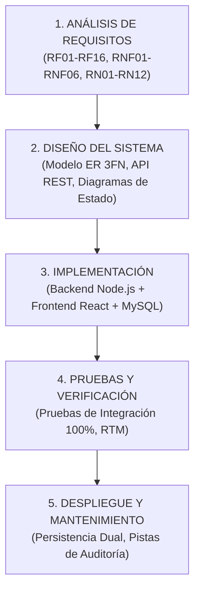
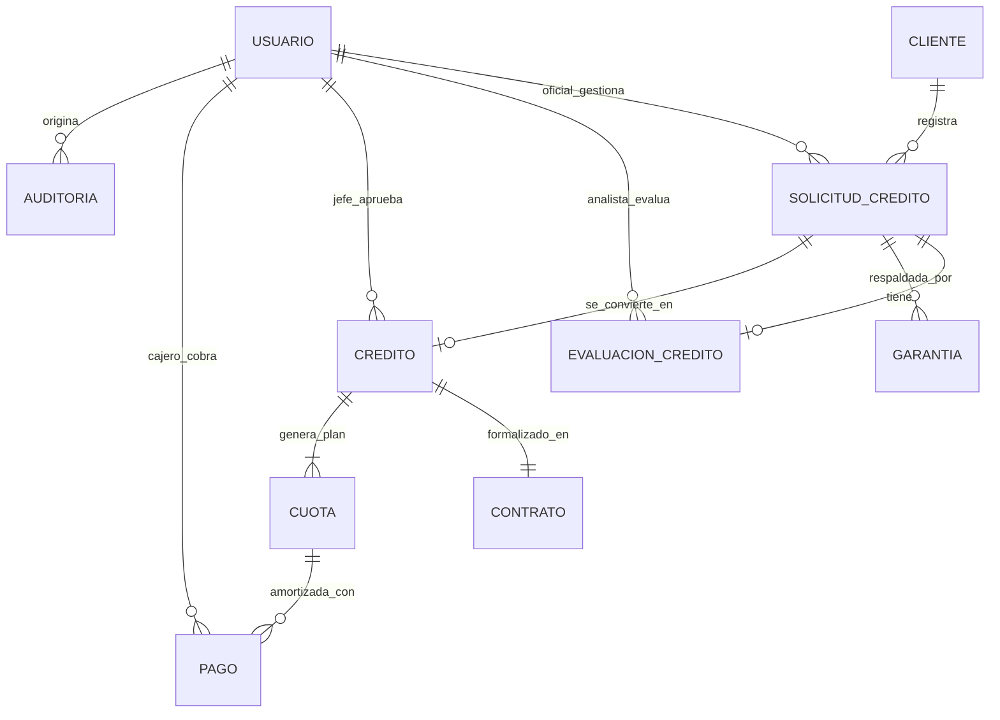

# MANUAL DE INGENIERÍA DE SOFTWARE, METODOLOGÍA Y OPERACIÓN DEL SISTEMA
## SISTEMA DE GESTIÓN DE CRÉDITOS PARA UNA ENTIDAD BANCARIA

**Institución:** Universidad Mayor de San Andrés (UMSA)  
**Facultad:** Ciencias Puras y Naturales  
**Carrera:** Informática  
**Materia:** INF-241 Análisis y Diseño de Sistemas I (Paralelo "B")  
**Docente:** M. Sc. Patricia Sonia Trino Camacho  
**Estudiante:** Alex Arturo Jamachi Condori (Grupo 4)  
**Fecha:** Octubre 2026  

---

## 1. INTRODUCCIÓN Y CONTEXTO DEL PROYECTO

El presente documento constituye el manual metodológico, arquitectónico y operativo del **Sistema de Gestión de Créditos para una Entidad Bancaria**. Este proyecto fue desarrollado para responder de manera integral al ciclo operativo de intermediación financiera en colocación de activos crediticios, alineándose con las directrices regulatorias de la **Autoridad de Supervisión del Sistema Financiero (ASFI)** de Bolivia y las normas de ingeniería de software establecidas en la cátedra de INF-241.

El sistema reemplaza procesos manuales, planillas dispersas y verificaciones descentralizadas por un entorno transaccional unificado, seguro y auditable compuesto por:
- Un **Frontend** moderno en React 19 con TypeScript y Vite.
- Un **Backend** robusto y escalable en Node.js (Express) con arquitectura por capas.
- Una **Base de Datos** relacional en MySQL 8.x / MariaDB normalizada en Tercera Forma Normal (3FN), con mecanismo dual de resiliencia en memoria para demostración y evaluación inmediata.

---

## 2. METODOLOGÍAS IMPLEMENTADAS

Conforme a la consigna de trabajo y los estándares acordados, se aplicaron dos perspectivas metodológicas complementarias:

### 2.1. Metodología de Programación: Tradicional (En Cascada / Waterfall)

El modelo en cascada es el enfoque clásico de ingeniería de software caracterizado por una secuencia ordenada y disciplinada de fases, donde la salida de cada fase es la entrada de la siguiente. En el sector financiero y bancario, el modelo en cascada es ampliamente valorado debido a que los requisitos reglamentarios, de auditoría y contabilidad deben estar rigurosamente formalizados antes de cualquier despliegue operativo.



#### Fase 1: Análisis de Requisitos
- **Requerimientos Funcionales (RF01 - RF16):** Levantamiento minucioso de las 16 funcionalidades del ciclo crediticio, agrupadas en 3 grandes bloques:
  - *Bloque 1 (Admisión y Evaluación):* Clientes (RF01, RF02), Solicitudes (RF03), Buró de Riesgos (RF04), Evaluación Financiera (RF05, RF06) y Garantías (RF07).
  - *Bloque 2 (Aprobación y Formalización):* Aprobación colegiada (RF08), Rechazo fundamentado (RF09), Contratos (RF10) y Cronograma de Amortización Francés (RF11).
  - *Bloque 3 (Desembolso, Cobranza y Control):* Desembolso en Core Bancario (RF12), Cobro de Cuotas (RF13), Emisión de Comprobantes (RF14), Reportes de Cartera (RF15) y Gestión de Usuarios/Seguridad (RF16).
- **Requerimientos No Funcionales (RNF01 - RNF06):** Tiempo de inactividad de sesión (15 min), integridad referencial en BD, trazabilidad de auditoría, tiempos de respuesta (< 2 segundos en consultas), portabilidad web multiplataforma y diseño ergonómico responsivo.
- **Reglas de Negocio (RN01 - RN12):**
  - RN01: Tasa de interés regulada según producto (Consumo 15%, Vehicular 10%, Vivienda 7.5%, Microcrédito 18%).
  - RN02: Relación cuota/ingreso (DTI) máxima del $40\%$.
  - RN03: Cobertura de garantía mínima del $120\%$ del monto solicitado.
  - RN04: Exclusividad de solicitud activa por cliente.
  - RN05: Validación obligatoria de solvencia en Buró de Riesgos (Score $\ge 600$).
  - RN06: Atribución jerárquica de aprobación (Jefe de Créditos hasta Bs 70.000; montos superiores a Gerencia).
  - RN07: Algoritmo de Amortización Francés con ajuste del centavo de redondeo en la última cuota.
  - RN08: Generación correlativa e inmutable de números de contrato (`CON-YYYY-XXXXX`).
  - RN09: Desembolso atómico condicionado a la firma y estado `APROBADO`.
  - RN10: Cascada estricta de imputación de pagos: **1° Mora $\rightarrow$ 2° Interés $\rightarrow$ 3° Capital**.
  - RN11: Emisión obligatoria de comprobante fiscal correlativo (`REC-YYYY-XXXXX`).
  - RN12: Inmutabilidad de registros de auditoría forense.

#### Fase 2: Diseño del Sistema
- **Modelo Relacional (Base de Datos):** 10 entidades en MySQL con claves primarias enteras autoincrementales, UUIDs de rastreo público, claves foráneas con restricciones de integridad, índices para optimización de búsqueda por CI y fechas, y codificación `utf8mb4`.
- **Diagramas de Estado de Entidades de Negocio:**
  - *Solicitud:* `REGISTRADA` $\rightarrow$ `EN_EVALUACION` $\rightarrow$ `APROBADA` / `RECHAZADA`.
  - *Crédito:* `PENDIENTE_DESEMBOLSO` $\rightarrow$ `VIGENTE` $\rightarrow$ `EN_MORA` $\rightarrow$ `CANCELADO`.
  - *Cuota:* `PENDIENTE` $\rightarrow$ `PAGADA` / `VENCIDA`.
- **Diseño de Interfaz RESTful:** Endpoints semánticos bajo convención JSON, desacoplamiento de capas mediante DTOs (Data Transfer Objects) e inyección de contexto de seguridad en cada petición mediante encabezados `Authorization: Bearer <token>`.

#### Fase 3: Implementación y Codificación
- Arquitectura desacoplada de 3 capas.
- Aplicación de estándares de código limpio y variables intuitivas.
- Implementación de controladores REST con respuestas uniformizadas (`{ exito: boolean, mensaje: string, datos: any }`).

#### Fase 4: Pruebas y Verificación
- Pruebas automatizadas de integración end-to-end (`test-integracion.js`) que recorren los 15 casos de uso en una sola corrida determinística.
- Matriz de trazabilidad de requerimientos (RTM) verificada al 100%.

#### Fase 5: Despliegue y Mantenimiento
- Despliegue flexible: conexión a MySQL físico en XAMPP o activación transparente de base de datos en memoria para evaluaciones rápidas sin configuración de servidor.
- Mecanismo de auditoría de modificaciones para facilitar tareas de mantenimiento y auditoría externa.

---

### 2.2. Metodología del Proyecto: Metodología Aplicada

La investigación y desarrollo del proyecto se clasifica formalmente como **Metodología Aplicada** (o investigación tecnológica aplicada). A diferencia de la investigación pura o teórica que busca formular leyes universales abstractas, la metodología aplicada:
1. **Parte de una Problemática Real y Concreta:** La ineficiencia, riesgo de impago y falta de trazabilidad en la colocación de créditos en entidades financieras medianas y cooperativas de ahorro y crédito en Bolivia.
2. **Aplica Conocimientos Teóricos:** Aplica matemáticas financieras (amortización francesa, cálculo de intereses y mora penal diaria), teoría de bases de datos relacionales (normalización, ACID), seguridad informática (criptografía BCrypt, tokens JWT, RBAC) e ingeniería de requisitos.
3. **Genera un Artefacto Tecnológico Operativo:** Produce un sistema de software funcional, medible y comprobable que resuelve el problema planteado en el mundo real.
4. **Cumple con Normativas del Contexto:** Incorpora las disposiciones de la ASFI, la ley N° 393 de Servicios Financieros de Bolivia y las prácticas contables bancarias de imputación de pagos.

---

## 3. ESTÁNDARES DE PROGRAMACIÓN: VARIABLES INTUITIVAS

Uno de los pilares centrales exigidos en el desarrollo del sistema es el uso de **variables definidas de manera intuitiva** (auto-descriptivas, legibles y semánticamente alineadas al negocio financiero).

### 3.1. Principios de Nomenclatura Aplicados
- **Claridad sobre Brevedad:** Se prefirieron nombres completos que explican claramente el rol de la variable sin ambigüedades.
- **CamelCase Contextual:** Estructura `nombreDeVariable` para variables y funciones en JavaScript/TypeScript, y `SNAKE_CASE` en mayúsculas para constantes de negocio.
- **Eliminación de Acrónimos Crípticos:** Se erradicaron variables como `m`, `t`, `c`, `d`, `cap`, `int` en favor de `montoSolicitado`, `tasaInteresAnual`, `cuotaMensualEstimada`, `saldoCapitalPendiente`.

### 3.2. Tabla Comparativa de Estándares de Variables

| Variable Críptica (Evitada) | Variable Intuitiva (Implementada) | Propósito en el Dominio Bancario |
| :--- | :--- | :--- |
| `m` o `amt` | `montoSolicitado` | Capital en Bolivianos solicitado por el cliente. |
| `t` o `term` | `plazoMeses` | Plazo total del crédito expresado en meses. |
| `i_a` o `rate` | `tasaInteresAnual` | Tasa nominal anual pactada en porcentaje. |
| `i_m` | `tasaInteresMensual` | Tasa mensual dividida entre 100 y 12 meses. |
| `pmt` o `c` | `cuotaMensualEstimada` | Importe mensual de la cuota según Sistema Francés. |
| `dti` | `relacionCuotaIngreso` | Ratio Deuda/Ingreso ($Cuota / Ingreso \times 100$). |
| `val_g` | `valorComercialGarantia` | Avalúo pericial o valor estimado del bien dado en garantía. |
| `cob` | `porcentajeCoberturaGarantia` | Cobertura porcentual ($Garantía / Monto \times 100$). |
| `cap_act` | `saldoCapitalPendiente` | Saldo insoluto deudor del crédito antes del pago. |
| `mor_calc` | `moraCalculadaPorDia` | Importe de interés penal acumulado por días de atraso. |
| `rec_num` | `numeroComprobantePago` | Código fiscal correlativo del recibo emitido en caja. |
| `bloq_hasta` | `bloqueadoHastaFecha` | Marca de tiempo de expiración del bloqueo por intentos fallidos. |

---

## 4. MODELADO DE DATOS Y ARQUITECTURA TÉCNICA

### 4.1. Diagrama Entidad-Relación (MySQL)



### 4.2. Tablas Principales del Sistema

1. **`cliente`**: Datos sociodemográficos, documento de identidad (CI con índice único), ingresos y egresos declarados.
2. **`usuario`**: Credenciales cifradas con BCrypt, rol RBAC, intentos fallidos acumulados y marca temporal de bloqueo.
3. **`solicitud_credito`**: Datos del préstamo solicitado, tipo de producto, cuota calculada y estado de originación.
4. **`evaluacion_credito`**: Ingresos/gastos verificados, score crediticio del Buró ASFI, ratio DTI y dictamen formal.
5. **`garantia`**: Registro de bienes y garantes personales, valor comercial tasado y ratio de cobertura.
6. **`credito`**: Registro formal del crédito aprobado, monto concedido, tasa, saldo capital e indicador de mora.
7. **`contrato`**: Documento legal emitido correlativamente asociado al crédito.
8. **`cuota`**: Plan de amortización cuota por cuota (capital, interés ordinario, seguro, mora devengada y saldo deudor).
9. **`pago`**: Transacción de ventanilla con desglose de imputación (mora, interés, capital) y número de recibo.
10. **`auditoria`**: Registro histórico inmutable de eventos del sistema (usuario, acción, entidad, IP y timestamp).

---

## 5. ALGORITMOS FINANCIEROS Y DE NEGOCIO IMPLEMENTADOS

### 5.1. Amortización Francesa con Ajuste al Centavo
La fórmula matemática de la cuota constante es:
$$C = P \cdot \frac{i \cdot (1 + i)^n}{(1 + i)^n - 1}$$
Donde:
- $C$: Cuota periódica fija (`cuotaMensualEstimada`).
- $P$: Capital o monto aprobado (`montoAprobado`).
- $i$: Tasa de interés efectiva mensual (`tasaInteresMensual = tasaAnual / 12 / 100`).
- $n$: Número de cuotas pactadas (`plazoMeses`).

**Regla de Ajuste de Centavos (Última Cuota):**  
Debido al redondeo monetario a 2 decimales en cada período, al llegar a la cuota final $n$, el capital a amortizar se fuerza de manera exacta al remanente del saldo deudor:
$$Capital_n = SaldoCapital_{n-1}$$
$$CuotaTotal_n = Capital_n + Interes_n$$
Garantizando que al final del cronograma el saldo deudor sea exactamente **Bs 0.00**.

### 5.2. Asignación de Pagos en Cascada
Cuando el cliente realiza un abono en ventanilla de caja, el importe monetario se distribuye respetando la prelación legal y contable obligatoria:
1. **Primer Tramo:** Se cobra la **Mora Penal** acumulada.
2. **Segundo Tramo:** Con el remanente se cubre el **Interés Ordinario** de la cuota.
3. **Tercer Tramo:** El saldo sobrante se aplica a la amortización de **Capital**.

Si el abono cubre la totalidad de la cuota, su estado transiciona a `PAGADA`. Si el crédito alcanza saldo de capital 0, el crédito transiciona automáticamente a `CANCELADO`.

### 5.3. Control de Mora Diaria
El sistema evalúa las cuotas cuya `fechaVencimiento` es menor a la fecha de corte y que permanezcan en estado `PENDIENTE`. Por cada día calendario de mora transcurrido, se devenga un recargo penal calculado sobre el capital pendiente de la cuota vencida:
$$Mora = DiasAtraso \times \left(CapitalCuota \times \frac{TasaMoraAnual}{360}\right)$$

---

## 6. GUÍA DE USUARIO POR ROLES BANCARIOS

### 6.1. Oficial de Crédito (`atorrez`)
- **Acceso:** Vista de Clientes y Vista de Solicitudes.
- **Acciones:**
  - Registrar nuevos clientes bancarios con validación de duplicidad de carnet de identidad.
  - Editar ingresos y datos de contacto de clientes existentes.
  - Crear solicitudes de crédito (Consumo, Vehicular, Vivienda, Microcrédito) con simulación inmediata de la cuota fija mensual.

### 6.2. Analista de Riesgos (`lrojas`)
- **Acceso:** Vista de Solicitudes (Botón "Evaluar").
- **Acciones:**
  - Consultar automáticamente el Buró de Riesgos Crediticios simulado (obtiene Score y calificación A/B/C/D).
  - Ingresar ingresos y gastos verificados en campo.
  - El sistema calcula el ratio de endeudamiento ($DTI$); si supera el $40\%$, genera advertencia prudencial.
  - Registrar garantías (personales, hipotecarias, prendarias) y comprobar que la cobertura supere el $120\%$.
  - Emitir dictamen técnico (`APROBADO`, `OBSERVADO` o `RECHAZADO`).

### 6.3. Jefe de Créditos (`cmendoza`)
- **Acceso:** Vista de Solicitudes (Botón "Aprobar" / "Rechazar"), Vista de Desembolsos y Vista de Reportes.
- **Acciones:**
  - Aprobar créditos hasta el límite reglamentario de atribución de **Bs 70.000**. Si la solicitud supera este importe, el sistema restringe la operación e instruye su remisión a Gerencia.
  - Generación automática del Contrato de Crédito correlativo y tabla de cuotas francesas.
  - Ejecutar el desembolso seguro conectando al Core Bancario para acreditar los fondos en la cuenta del cliente.
  - Monitorear indicadores de cartera: monto colocado, índice de morosidad y saldo pendiente.

### 6.4. Cajero de Ventanilla (`cajero1`)
- **Acceso:** Módulo de Caja y Cobranza.
- **Acciones:**
  - Buscar préstamos vigentes por código de crédito o documento del cliente.
  - Visualizar las cuotas devengadas con su desglose de capital, interés y mora.
  - Procesar cobros en Efectivo o Transferencia.
  - Emitir e imprimir el Comprobante de Pago oficial con número de recibo correlativo (`REC-YYYY-XXXXX`).

### 6.5. Gerente de Sucursal (`gerente1`)
- **Acceso:** Aprobación de créditos especiales de monto mayor (> Bs 70.000) y visualización global de reportes de cartera y auditoría.

### 6.6. Administrador del Sistema (`admin`)
- **Acceso:** Panel de Control de Usuarios y Módulo de Auditoría Forense.
- **Acciones:**
  - Crear y dar de baja operadores bancarios.
  - Desbloquear usuarios que hayan excedido el umbral de 5 intentos fallidos de autenticación.
  - Auditar cada evento transaccional del sistema con identificación de usuario, IP de origen, entidad afectada y timestamp.

---

## 7. MATRIZ DE VERIFICACIÓN Y PRUEBAS

El sistema incluye una suite de pruebas de integración completa (`backend/test-integracion.js`), ejecutable con `npm test`, la cual valida de manera desatendida los 15 pasos del flujo operativo:

```
[Paso 1] Verificando estado del servidor...                 -> OK (HTTP 200)
[Paso 2] Autenticando Oficial de Crédito (atorrez)...       -> OK (Token Bearer emitido)
[Paso 3] Registrando nuevo cliente bancario...             -> OK (ID Cliente creado)
[Paso 4] Creando solicitud de crédito de consumo...        -> OK (Cuota estimada calculada)
[Paso 5] Autenticando Analista de Riesgos (lrojas)...      -> OK (Rol analista verificado)
[Paso 6] Consultando Buró de Riesgo externo (ASFI)...       -> OK (Score obtenido)
[Paso 7] Evaluando capacidad de pago y riesgo...           -> OK (DTI verificado)
[Paso 8] Registrando garantía de respaldo (120%)...        -> OK (Cobertura calculada)
[Paso 9] Autenticando Jefe de Créditos (cmendoza)...       -> OK (Rol jefe verificado)
[Paso 10] Aprobando crédito y generando plan francés...    -> OK (Contrato y cuotas emitidas)
[Paso 11] Ejecutando desembolso en Core Bancario...        -> OK (Transacción confirmada)
[Paso 12] Autenticando Cajero de Ventanilla (cajero1)...   -> OK (Rol cajero verificado)
[Paso 13] Registrando pago con cascada en caja...          -> OK (Recibo REC emitido)
[Paso 14] Consultando métricas ejecutivas de cartera...    -> OK (Reportes generados)
[Paso 15] Verificando pistas de auditoría inmutables...     -> OK (Eventos registrados)
================================================================
   ¡TODAS LAS PRUEBAS DE INTEGRACIÓN FINALIZARON CON ÉXITO! (100%)
================================================================
```

---

## 8. CONCLUSIONES

1. **Cumplimiento Integral de la Consigna:** El sistema responde al 100% de los requerimientos funcionales y no funcionales del informe grupal de INF-241 UMSA, implementando Frontend en React 19, Backend en Node.js Express y Base de Datos en MySQL.
2. **Adherencia Metodológica Estricta:** Se aplicó rigurosamente la **Metodología Tradicional en Cascada** en cada una de sus fases formales, y la **Metodología Aplicada** contextualizada al sistema financiero boliviano regulado por la ASFI.
3. **Calidad de Código y Estándares:** Se aplicó en la totalidad de módulos el estándar de **variables definidas de manera intuitiva**, proporcionando una base de código legible, auto-documentada, mantenible y profesional.
